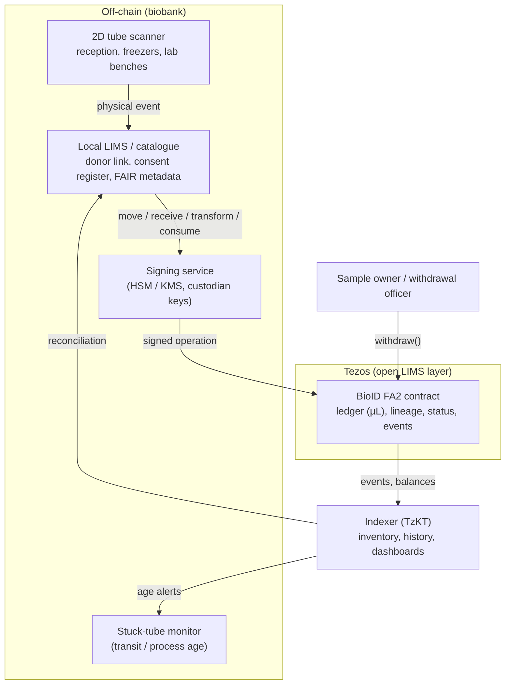

# bioid.tez

Tips in tez are welcome at [`bioid.tez`](https://tzkt.io/tz1Tm5drMq3zueTpSonJ2FE7P3MBZN9RBNta).

BioID is an open recipe for tamper-evident biobank sample tracing on tezos blockchain that any biobank can adapt. Fork it, change it, and run it beside your own LIMS. It is a shared design, not a product and not a patentable invention.

The recipe traces physical tubes on Tezos. Each tube is one [FA2](https://docs.tezos.com/architecture/tokens/FA2) token (TZIP-12). The balance is the volume left in that tube, in µL. When that same tube changes place, the same token moves. A new container, such as an aliquot or an extract, is a new token, and only the volume taken from the parent is burned. The parent token continues with whatever volume remains. Places and processes are wallets: storage, lab benches, work in progress, and shipments in transit. Accepting a shipment is a second, explicit step. Withdrawing consent freezes the lineage first and burns a tube only after physical destruction is confirmed. The off-chain link to the person is then crypto-shredded.

It is an open chain-of-custody and inventory layer beside a local LIMS. The LIMS keeps consent, donor links and clinical context. Personal data stays off-chain. Off-chain records are meant to use shared vocabularies — MIABIS, FHIR Specimen, GA4GH DUO, SPREC and FAIR — while the token follows TZIP-12 and TZIP-21.

## White paper

A draft white paper for community feedback and potential adopters is in [`docs/whitepaper/BioID-whitepaper-v0.3.md`](docs/whitepaper/BioID-whitepaper-v0.3.md), with a [Word](docs/whitepaper/BioID-whitepaper-v0.3.docx) and [PDF](docs/whitepaper/BioID-whitepaper-v0.3.pdf) copy. It describes the design, reports a synthetic mainnet trial, and invites comment.

## Core operating principles

An ecosystem that adopts the recipe follows the [core operating principles](docs/principles.md). In short: no personal data on-chain, the ledger follows the physical tube, every holding wallet is registered and typed, and a hand-over between sites is a ship followed by a receive. Wallets should carry a readable Tezos Domains name.

The types, the allowed transitions and the registry format are in [Wallet types](docs/wallet-types.md). The JSON Schema is [`schemas/wallet-registry.schema.json`](schemas/wallet-registry.schema.json). The synthetic example is [`examples/wallet-registry.example.json`](examples/wallet-registry.example.json). This repository holds the format and that example only. A real ecosystem publishes its own registry elsewhere.

## Problem

What a tube is, where it has been, how much is left, and whether it may still be used are usually locked inside one laboratory's LIMS. A partner who receives the tube cannot independently check the hand-over. Aliquots and extracts lose a shared, inspectable parent link. Consent withdrawal is a local database update, with no common proof that further use stopped.

## How it works

Scanners and the local LIMS stay the system of entry. A signing service turns a physical event into a signed operation. The contract records the custody change. An indexer such as [TzKT](https://tzkt.io/) reads balances and events and feeds them back so the LIMS can reconcile.



Day to day the contract does six things:

- **Mint** a primary tube into a wallet. The balance is the volume in µL. Minting is also how a new daughter tube or extract appears.
- **Move** the same token when that tube changes place, between storage, process and transit wallets. A move does not mint or burn.
- **Receive** is the second step of a hand-over. Only the receiving custodian can accept a tube out of transit. Same token.
- **Transform** mints child tokens (aliquot, split, DNA or RNA extract, library) that point at their parent, and burns only the volume taken from the parent.
- **Consume** burns volume that was used, discarded or lost.
- **Withdraw** freezes every descendant of a root sample. A tube is burned with reason `withdrawn-destroyed` only after a custodian confirms physical destruction. The consent-register entry stays off-chain and can be deleted.

### Move or mint?

The same physical tube, in a new place, is a move of the token it already has. The transfer history is the journey. A new container gets a new token, because it has its own 2D code: scanning it shows that tube's journey and, through `parent_id`, where the volume came from. The parent is not replaced. The full rule is in [Wallet types](docs/wallet-types.md#move-or-mint).

| What happened | On-chain |
|---|---|
| Same tube changes place (storage, intake, process, transit, quarantine) | **MOVE** the existing token. No mint, no burn. |
| New container (aliquot, extract, library, …) | **MINT** a new token with `parent_id`. **BURN** only the volume taken. The parent keeps the rest. |
| Volume used up, lost or destroyed | **BURN** that amount, with a reason code. |
| Measured volume differs from nominal | `adjust_volume`. No mint. |

The diagram above is the architecture overview from the concept note.

## Status

Shadownet testnet demo, synthetic data only. The FA2 contract is deployed as [`KT1HpDatoa5tHDctAQDY7wQgVEnrWJ9S3vix`](https://shadownet.tzkt.io/KT1HpDatoa5tHDctAQDY7wQgVEnrWJ9S3vix). The [phone viewer](app/README.md) reads it. Mainnet is not in use. Tube codes, volumes, wallet names and events in this repository are invented.

## Repository layout

| Path | What it is |
|---|---|
| [`docs/`](docs/index.md) | Principles, wallet types, LIMS integration, concept note, argumentation, PDFs, and the GitHub Pages site |
| [`schemas/`](schemas/wallet-registry.schema.json) | JSON Schema for a wallet registry |
| [`contracts/`](contracts/README.md) | SmartPy FA2 contract and the Shadownet origination script |
| [`pilot/`](pilot/README.md) | Synthetic public-demo feed: reception, aliquots, RNA extract, retrieval for an external user |
| [`bridge/`](bridge/README.md) | Reference LIMS bridge. Runs offline on a mock ledger |
| [`app/`](app/README.md) | Static phone viewer: scan or open a tube, read volume, custody, lineage, and datasets from TzKT |
| [`examples/`](examples/README.md) | Synthetic sample data, a synthetic wallet registry, and a synthetic LIMS feed |

## Documentation

- [Core operating principles](docs/principles.md)
- [Wallet types](docs/wallet-types.md) · [registry schema](schemas/wallet-registry.schema.json) · [synthetic registry](examples/wallet-registry.example.json)
- [LIMS integration](docs/lims-integration.md) · [reference bridge](bridge/README.md)
- [Synthetic public demo](pilot/README.md) · [FA2 contract](contracts/README.md) · [phone viewer](app/README.md)
- [Concept note](docs/concept-note.md) · [PDF](docs/pdf/concept-note.pdf)
- [Argumentation](docs/argumentation.md) · [PDF](docs/pdf/argumentation.pdf)
- [Contributing](CONTRIBUTING.md)
- [Security and privacy](SECURITY.md)

## Site (GitHub Pages)

`docs/` is a minimal [Jekyll](https://jekyllrb.com/) site using the [Minima](https://github.com/jekyll/minima) theme, which GitHub Pages supports. The site is ready to publish from the `/docs` folder on `main`. Pages stays off until it is turned on in the repository settings.

When the repository is public and you want the site:

1. Open **Settings → Pages**.
2. Under **Build and deployment**, choose **Deploy from a branch**.
3. Select branch `main` and folder `/docs`, then save.

The project-site base URL is set in [`docs/_config.yml`](docs/_config.yml) as `/BioID`, matching this repository name. Change `baseurl` if the repository is renamed.

GitHub renders Mermaid in the Markdown files directly. The Pages layout also loads Mermaid so the same fences render on the site.

Optional local preview, from a machine with Ruby and Bundler:

```bash
cd docs
bundle install
bundle exec jekyll serve
```

## Support BioID

Tips in tez are welcome. Send them to `bioid.tez`, which resolves to `tz1Tm5drMq3zueTpSonJ2FE7P3MBZN9RBNta`. [View the address on TzKT](https://tzkt.io/tz1Tm5drMq3zueTpSonJ2FE7P3MBZN9RBNta).

Send only on Tezos mainnet, and double-check the address in your wallet. Most Tezos wallets accept `bioid.tez` directly. Tips are voluntary. They fund development and hosting. There are no perks.

## Licence

Code in this repository is under the [MIT License](LICENSE), copyright BioID contributors.

Documentation, including the concept note, the argumentation and the other pages under `docs/`, is under [CC BY 4.0](LICENSE-docs). The synthetic examples are included in that documentation licence.
