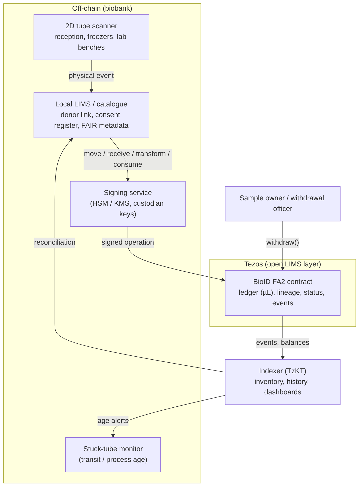
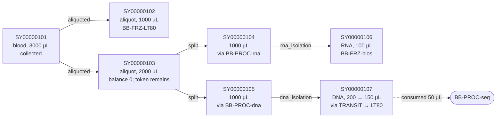
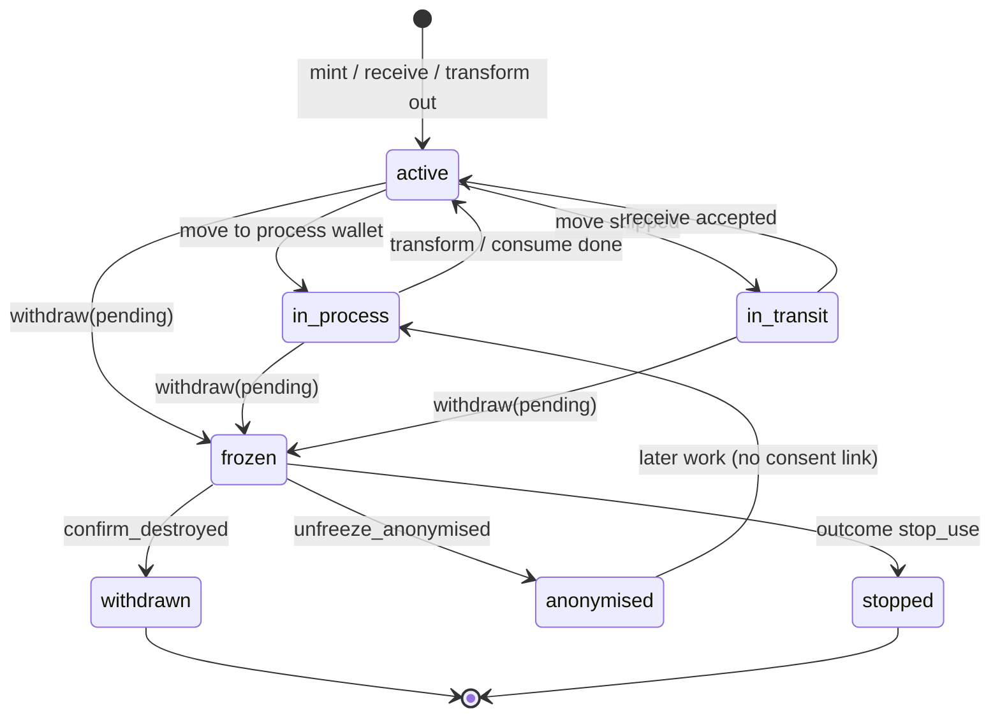

**BioID concept note** · Draft. Nothing has been deployed. **All tube codes, addresses, volumes and events below are synthetic.**

## 1. The idea in one paragraph

BioID mirrors every physical tube or container in a biobank as a token on Tezos, and the places and processes a tube passes through as wallets. The token's balance is the tube's volume in µL. When a tube moves (courier → reception → freezer → lab), that same token moves between the matching wallets. A location change does not mint or burn. When material is taken out and used up, that volume is burned. When a new container is made (an aliquot, a split, an extract), a new child token is minted that points to its parent, and only the volume taken from the parent is burned. The parent token continues with whatever volume remains. The chain then holds a tamper-evident, openly verifiable record of every tube: where it is, how much is left, what it came from and what happened to it. Each lineage has a recorded owner, separate from where the tubes sit, so the owner can withdraw a sample and everything derived from it. No personal or donor-linkable data goes on-chain. In practice BioID is an open chain-of-custody and inventory layer: it complements the local LIMS rather than replacing it.

## 2. Core design

**One FA2 multi-asset contract (TZIP-12), one token per tube.** Each physical tube or container is one `token_id`, keyed by its 2D tube code. The **balance is the volume in µL** (an integer, see open questions on precision). Because a tube can only be in one place, the whole balance of a token always sits in a single wallet. Using FA2 means standard wallets, explorers and indexers (TzKT, Better Call Dev) can read the data without custom tooling.

**Token metadata** (small, on-chain, non-personal):

| Field | Example (synthetic) | Purpose |
|---|---|---|
| `code` | `SY00000107` | 2D tube code |
| `parent_id` | `SY00000105` (none for a primary sample) | lineage tree |
| `root_id` | `SY00000101` | links to owner and makes withdrawal fast |
| `sample_type` | `blood`, `aliquot`, `RNA`, `DNA` | coarse type only |
| `created_by` | `collected`, `aliquoted`, `split`, `rna_isolation`, `dna_isolation` | operation that created the tube |
| `recorded_volume` | `200` (µL) | volume recorded when the tube was created |
| `consent_ref` | opaque random ID or salted hash | pointer into the off-chain consent register; never the person |
| `meta_uri`, `meta_hash` | URI + SHA-256 | link to the off-chain FAIR/MIABIS record |

**Wallets are places and processes, not people.** Four kinds of wallet hold tubes:

| Kind | Examples (synthetic) | Role |
|---|---|---|
| Storage | `BB-RECEPTION`, `BB-FRZ-LT80` (−80 °C), `BB-FRZ-bios` | resting inventory |
| Process | `BB-PROC-rna`, `BB-PROC-dna`, `BB-PROC-seq` | tube is being worked on until the transform finishes |
| Transit | `TRANSIT-courier`, `TRANSIT-partner-X` | tube is between sites, awaiting `receive` |
| Lab / bench | `BB-LAB-mol` | short-term holding before or after a process |

People and organisations (custodians, owners) do not hold tokens; they *authorise* actions. Process and transit wallets are the answer to the worry that an open ledger drifts from reality while a sample is mid-process or mid-shipment: the tube is always in a named wallet that matches its physical state. See §7.

The controlled vocabulary and the allowed transitions are specified in [Wallet types](wallet-types.md). That note splits reception out of long-term storage, and treats a bench that only holds tubes as storage; transform and consume-for-use stay on a process wallet. Ecosystems that adopt the recipe also follow the [core operating principles](principles.md).

**Four event types**, each carrying a reason code and an optional reference hash (e.g. of a shipping manifest, protocol or run sheet). Each is emitted as a Tezos contract event (`EMIT`) so that indexers can pick it up:

* **MOVE**: an FA2 transfer of the same token, whole balance, between wallets. This is the only way to record a location change. Reasons: `shipped`, `stored`, `moved`, `thawed`, `to_process`, `qc_hold`, …
* **RECEIVE** (accept): the receiving custodian confirms a tube that sits in a transit wallet into one of their own wallets. Same token. Until then the tube stays in transit. Reasons: `received`.
* **TRANSFORM**: mint one or more new tokens with `parent_id`, and burn only the volume taken from the parent, all in one atomic operation. The parent token continues with the remainder (zero, if the whole remaining volume was taken). This covers aliquoting and splitting (volume roughly conserved across parent remainder plus children) and isolations (DNA/RNA extraction, where volume is *not* conserved: 1000 µL of blood can give 200 µL of DNA extract). An extract is a new token because it is a new tube with its own 2D code, not a renamed parent and not a move.
* **CONSUME**: burn an amount from a tube with a reason: `consumed` (e.g. sequencing, an assay), `discarded`, `lost`. Burning, not a discard wallet, keeps every balance equal to the physical volume left, while the burn event stays on the chain.

**Withdrawal (freeze-then-burn).** The owner (or a delegated withdrawal officer) names a root sample and an outcome. The contract walks the lineage tree and immediately **freezes** every descendant (no further move, transform or consume). Each tube is burned with reason `withdrawn-destroyed` only after physical destruction is confirmed, so the chain never runs ahead of the freezer. Other outcomes (anonymise and keep; stop further use) are supported. See §8.

**Owner is separate from location.** `owner : big_map(root_id, address)` records who has legal control of a primary sample. Every descendant inherits that owner through `root_id`. Custodians move tubes day to day; only the owner (or the biobank acting for them) can withdraw.

### Contract sketch

```
storage:
  ledger      : big_map (address * token_id) nat     // FA2 balances, volume in µL
  location    : big_map token_id address             // the one wallet holding the tube
  token_meta  : big_map token_id {code; parent_id?; root_id; sample_type;
                                  created_by; recorded_volume; consent_ref;
                                  meta_uri; meta_hash}
  children    : big_map token_id (set token_id)      // lineage tree
  owner       : big_map token_id address             // per root sample
  locations   : big_map address {custodian; kind; label}
                                                 // kind = storage | process | transit | lab
  custodians  : big_map address (set address)        // organisation -> signer keys
  status      : big_map token_id
                (active | in_process | in_transit | frozen
                 | anonymised | stopped | withdrawn)
  pending_receive : big_map token_id {from; to_hint?; shipped_at}
  admin       : address                              // governance multisig

entrypoints:
  transfer, balance_of, update_operators             // FA2 standard (policy-restricted)
  mint_primary(code, owner, to_wallet, volume_ul, type, consent_ref, meta_uri, meta_hash)
  move(token_id, to_wallet, reason, ref_hash?)       // whole tube, emits MOVE
  receive(token_id, to_wallet, ref_hash?)            // receiver accepts from transit
  transform(inputs:[(token_id, amount)], outputs:[(code, volume_ul, type, to_wallet)],
            op, ref_hash?)                           // aliquot/split/isolate, emits TRANSFORM
  consume(token_id, amount, reason, ref_hash?)       // emits CONSUME
  adjust_volume(token_id, delta, reason)             // measured vs nominal corrections
  withdraw(root_id, outcome)                         // freeze lineage; outcome =
                                                     //   destroy | anonymise | stop_use
  confirm_destroyed(token_id, ref_hash?)             // burn after physical destruction
  unfreeze_anonymised(token_id)                      // after consent link shredded
  register_location / set_custodian / set_owner      // admin & governance
```

### Architecture overview



Day to day, the scanner drives the system: scanning a tube at a station creates a LIMS event, and the signing service turns it into an on-chain operation. The indexer feeds the on-chain state back so that any difference between the physical and the on-chain inventory is flagged. BioID is the open chain-of-custody and inventory layer; the local LIMS keeps consent, donor links, detailed protocols and clinical context.

## 3. Key management for location wallets

Freezers cannot sign transactions, so someone has to control the location wallets. Options:

1. **Contract-level custodian roles (recommended).** Each location is registered with a custodian organisation (e.g. all `BB-*` wallets belong to the biobank custodian). The transfer policy lets any signer key of that custodian act on tubes held in its wallets. Location wallets then need no private keys of their own. Cross-organisation hand-overs use the two-step transit pattern (§7): the sender moves the tube into a transit wallet (`shipped`) and only the receiving custodian can call `receive` to land it in their own wallet. Custodian keys sit in a multisig or an HSM/KMS and can be rotated without touching the locations.
2. **One key per location, plus FA2 operators.** This is fully standard, but means many keys to manage and rotate.
3. **Locations as smart contracts (KT1).** Flexible access rules per site, but more contracts to audit.

The owner's withdrawal right overrides custodian rights. An admin multisig (e.g. the quality manager plus IT) registers locations and custodians.

## 4. GDPR, ethics and standards

* **Nothing personal on-chain.** Only tube codes, wallet labels, coarse sample types, volumes, reason codes, timestamps, opaque `consent_ref` values and hashes. No donor or animal-owner IDs, names, dates of birth, holding numbers or coordinates. Do not hash personal identifiers either, because low-entropy hashes can be reversed by brute force. Prefer a random opaque ID as `consent_ref`, with the mapping held only in the consent register.
* **The donor / owner link stays off-chain** in the biobank's consent register. Withdrawal of consent is covered in detail in §8.
* **Residual risk.** Pseudonymised codes are still personal data for whoever holds the key, so a DPIA is advisable, with the biobank as controller. Exact legal requirements to be confirmed with the data protection officer of the biobank operating the system; this note states only GDPR basics and makes no further legal claims.
* **ISO 20387** requires traceability, chain of custody and documented processes. BioID supplies the evidence; it does not replace the QMS. **BBMRI-ERIC / MIABIS and FAIR:** descriptive metadata stays in off-chain catalogues, referenced by URI and hash.

## 5. Worked example: a blood sample through the lab (synthetic)

**Synthetic data only:** the tube codes `SY000001xx` and all volumes are made up. Owner of root `SY00000101`: `STUDY-OWNER` (the study). `consent_ref` = `cref-a1b2c3` (opaque; the person is not on-chain).

Place changes (1b, 3, the move in 4, 5a, 6a, the move in 6c, 7a, 7b) move or receive the same token. They do not mint or burn. Each transform below happens to take the parent's whole remaining volume, so that parent continues at 0 µL. It is not replaced. Taking 500 µL from a 2000 µL tube would burn 500 and leave the parent at 1500. The rule is in [Wallet types](wallet-types.md#move-or-mint).

| # | Physical event | On-chain action | Token(s) | Wallet | Balance after |
|---|---|---|---|---|---|
| 1a | Blood tube collected in the field and handed to the courier | `mint_primary`, `created_by=collected`, into transit | `SY00000101` blood | `TRANSIT-courier` | 3000 µL (nominal); status `in_transit` |
| 1b | Tube arrives at the lab; reception scans and measures volume | `receive` into reception (only the receiving custodian can call this); measured 3000 µL confirms nominal (otherwise `adjust_volume`) | `SY00000101` | `BB-RECEPTION` | 3000 µL; status `active` |
| 2 | Aliquoted into two new daughter tubes, 1 ml and 2 ml. The parent tube is still there, now empty. | `transform`, `aliquoted`: burn only the 3000 µL taken from `…101`; mint two new tokens with parent `…101`. Parent token continues at 0. | `…101` remains; new `SY00000102`, `SY00000103` | children minted at `BB-RECEPTION`, where the parent already sits | `…101` 0; `…102` 1000 µL; `…103` 2000 µL |
| 3 | 1 ml tube put into long-term −80 °C storage | `move`, `stored` | `SY00000102` | `BB-FRZ-LT80` | 1000 µL |
| 4 | Same 2 ml tube moved to the molecular lab, then split into two new tubes | `move` of `…103`, `moved` (no mint, no burn); then `transform`, `split`: burn only the 2000 µL taken; mint two children. Parent token continues at 0. | `…103` remains; new `SY00000104`, `SY00000105` | same token moved to `BB-LAB-mol`; children minted there | `…103` 0; `…104` 1000 µL; `…105` 1000 µL |
| 5a | `…104` starts RNA isolation | `move`, `to_process` | `SY00000104` | `BB-PROC-rna` | 1000 µL; status `in_process` |
| 5b | RNA isolation produces a new extract tube, which is minted straight into freezer "bios" | `transform`, `rna_isolation`: burn only the 1000 µL taken from `…104`; mint new token `…106`. Parent stays put at 0. The mint is the new tube, not a move of the parent. | `…104` remains; new `SY00000106` RNA | parent stays in `BB-PROC-rna`; child minted into `BB-FRZ-bios` | `…104` 0; `…106` 100 µL |
| 6a | `…105` starts DNA isolation | `move`, `to_process` | `SY00000105` | `BB-PROC-dna` | 1000 µL; status `in_process` |
| 6b | DNA isolation produces a new extract tube | `transform`, `dna_isolation`: burn only the 1000 µL taken from `…105`; mint new token `…107`. Parent continues at 0. | `…105` remains; new `SY00000107` DNA | parent stays in `BB-PROC-dna`; child minted into `BB-LAB-mol` | `…105` 0; `…107` 200 µL |
| 6c | 50 µL of the same DNA extract used for sequencing | `move` the same token `…107` to `BB-PROC-seq` (no mint); `consume` burns 50 µL, `consumed` (ref = hash of run sheet). The token continues at 150 µL. | `SY00000107` | `BB-PROC-seq` then back / stay | 150 µL |
| 7a | Remaining DNA extract packed for long-term storage | `move`, `shipped` | `SY00000107` | `TRANSIT-internal` | 150 µL; status `in_transit` |
| 7b | Storage site accepts the tube | `receive` into −80 °C freezer | `SY00000107` | `BB-FRZ-LT80` | 150 µL; status `active` |

**If the donor or owner then withdraws consent:** `withdraw(SY00000101, destroy)` freezes `…102`, `…106` and `…107` immediately. Custodians destroy the tubes and call `confirm_destroyed` for each; only then is the balance burned with reason `withdrawn-destroyed`. The consent register entry and salt are deleted (crypto-shredding). See §8.

### Lineage tree (synthetic)



## 6. Wallets as live inventory

Each storage wallet holds the tubes that are physically in it, so an indexer such as TzKT gives inventory and audit log for free:

* **Current inventory:** `GET /v1/tokens/balances?account=<wallet>&balance.gt=0` lists every tube in the wallet with its remaining volume in µL.
* **Full in/out history:** `GET /v1/tokens/transfers?anyof.from.to=<wallet>` plus the BioID events give every arrival, departure, consumption and burn with timestamp, reason and signer.

Inventory after step 7b of the worked example (synthetic):

| Wallet | Tube | Type | Parent | Created by | Balance | Last event |
|---|---|---|---|---|---|---|
| `BB-FRZ-LT80` (−80 °C) | `SY00000102` | aliquot | `SY00000101` | aliquoted | 1000 µL | step 3, `stored` |
| `BB-FRZ-LT80` (−80 °C) | `SY00000107` | DNA extract | `SY00000105` | dna_isolation | 150 µL | step 7b, `received` |
| `BB-FRZ-bios` | `SY00000106` | RNA extract | `SY00000104` | rna_isolation | 100 µL | step 5b, `stored` |

Process and transit wallets are inventory too: a query on `BB-PROC-rna` or `TRANSIT-courier` lists every tube currently mid-process or mid-shipment.

**Limitation: rack, box and position.** A wallet tells you *which freezer*, not where in it. Options:

1. **Sub-wallets per rack or box** (e.g. `BB-FRZ-bios/R3/B07`). Position becomes part of the ledger and every rearrangement is logged, but there are many more wallets to register, and each rearrangement inside a freezer costs a transaction.
2. **Position fields in token metadata.** With one token per tube this maps cleanly (one tube, one position), but the metadata has to be updated on every rearrangement.
3. **Position in the move event payload** (e.g. `to_position = "R3/B07/C4"`). Cheap, but the current position has to be reconstructed by the indexer and is not enforced by the contract.

A pragmatic mix: sub-wallets down to box level, with the slot kept in the LIMS or in the event payload.

## 7. In-between states: processing and transit

A common worry with an open ledger is that it drifts from reality while a sample is mid-process (hours on a bench) or mid-shipment (days in a courier bag). The design treats those periods as first-class states, not gaps:

**Process wallets.** When a tube is about to be worked on, that same token is moved into an explicit process wallet such as `BB-PROC-rna`, `BB-PROC-dna` or `BB-PROC-seq`. Its status becomes `in_process`. It stays there until the work finishes. A `transform` mints any new containers and burns only the volume taken from the parent; the parent token remains in the process wallet with whatever is left, and a child may be minted into a storage or lab wallet. A later change of place is a `move` of that token, not another mint. Anyone looking at the chain can see that the tube is currently in RNA isolation, not sitting forgotten in a freezer. If isolation fails, the process wallet still holds the parent until the remaining volume is burned as `discarded` or the same token is moved back.

**Transit wallets and two-step handover.** Shipments never jump directly from one lab's storage wallet to another's. The sender moves the tube into a transit wallet (`TRANSIT-courier`, `TRANSIT-partner-X`, …) with reason `shipped`; status becomes `in_transit`. Only the receiving custodian can call `receive(token_id, to_wallet)`, which lands the tube in their own wallet and clears the pending-receive record. Until that confirmation, the tube is visibly still in transit. This gives a signed record from both parties and stops a sender from silently claiming a delivery that never happened.

**Openness becomes an advantage.** Because every process and transit wallet is public, anyone (and any script) can see how long a tube has been mid-process or mid-shipment. A simple off-chain monitor watching the indexer can flag stuck tubes, e.g. `in_transit` for more than *N* days or `in_process` for more than a shift. That is hard to get from a closed LIMS alone.

**BioID as an open LIMS layer.** The chain provides chain of custody, live inventory and stuck-tube alerts. It does **not** replace the local LIMS: consent, donor/owner links, detailed protocols, QC results and clinical context stay off-chain. The two systems reconcile against each other.

## 8. Withdrawal of consent

Applies to human participants and, for animal samples, to the animal's owner (the animal itself is not a GDPR data subject, but the owner's identity is personal data). Exact legal requirements to be confirmed with the data protection officer of the biobank operating the system; this section states design intent and GDPR basics only.

**The person is never on-chain.** The primary tube token carries only an opaque `consent_ref` (a random ID, or a salted hash of an internal key). The mapping from `consent_ref` to the participant or animal owner lives only in the biobank's consent register.

**Two-phase withdrawal (freeze-then-burn).** This is the agreed design; immediate burn is no longer under consideration.

1. The biobank (or the owner, if they hold a wallet) calls `withdraw(root_id, outcome)` on the primary tube. The contract walks the lineage tree and immediately **freezes** every descendant: no further `move`, `transform` or `consume` is allowed. Status becomes `frozen`.
2. Custodians locate each physical tube. For outcome `destroy`, they destroy it and call `confirm_destroyed(token_id)`, which burns the remaining balance with reason `withdrawn-destroyed`. The chain therefore never claims a tube is gone before the freezer does.
3. The consent register entry and its salt are deleted (**crypto-shredding**). The on-chain history remains as an unlinkable audit of codes that can no longer be tied to anyone.

**Three outcomes** (chosen when `withdraw` is called):

| Outcome | On-chain effect | Physical / off-chain |
|---|---|---|
| **Destroy** | freeze → `confirm_destroyed` burns with `withdrawn-destroyed` | tubes destroyed; register entry shredded |
| **Anonymise and keep** | freeze → after shredding, `unfreeze_anonymised`; status `anonymised` | tubes kept; consent link permanently severed |
| **Stop further use** | freeze indefinitely; status `stopped` | tubes retained but locked; no new assays |

Results already used in completed analyses or publications can usually be retained; whether they must be withdrawn depends on the consent form and applicable law (to be checked with the DPO).

**Animal samples.** The animal is not a GDPR data subject, but the owner's personal data is. The same off-chain consent register and opaque `consent_ref` apply. The owner may hold their own wallet and trigger `withdraw` directly.

### Tube status diagram (synthetic)



## 9. Alternatives considered (briefly)

* **One token per sample with portion counts** (an earlier draft): fewer tokens, but it loses per-tube identity, partial volumes and a clean lineage.
* **Status-only contract** (one record per sample holding its location and state): simpler, but it says nothing about volumes or lineage, and it handles samples spread over many tubes poorly.
* **Immediate burn on withdrawal:** rejected in favour of freeze-then-burn so the chain never runs ahead of physical destruction.
* **Tezos tickets:** strict custody inside contracts, but harder to inspect with standard tools.
* **Hash anchoring only** (keep the log in the LIMS and anchor Merkle roots on-chain): cheapest and most private, but the history is no longer openly readable.
* **Permissioned/private chain, a Tezos smart rollup or Etherlink:** more control over visibility and fees, but less open verifiability.

## 10. Open questions for you

1. **Volume units and precision:** are whole µL enough, or should the unit be 0.1 µL or nL (via FA2 `decimals`) for small extracts? How should non-liquid containers (tissue, swabs, slides) be counted, e.g. mg or a count of 1?
2. **Volume corrections:** how should measured and nominal volumes, evaporation, dead volume and pipetting loss be recorded? Options are `adjust_volume` with a reason, a loss output in each `transform`, or tolerating small differences off-chain.
3. **Ownership:** who is the on-chain owner (the project, the biobank, or a delegated ethics/withdrawal officer acting for the donor)? Can ownership of a lineage branch be transferred, e.g. on a material transfer agreement? For animal samples, should the owner hold a wallet by default?
4. **Who controls location wallets:** the custodian-role model (proposed), keys per location, or contract wallets? How should partner institutions be onboarded, including their transit wallets and `receive` rights?
5. **Withdrawal outcomes in practice:** which of destroy / anonymise / stop_use will the biobank operating the system actually offer? Should completed analysis results always be retained? For large trees, gas limits may require `withdraw` and `confirm_destroyed` to run in batches.
6. **Stuck-tube thresholds:** what *N* days in transit, and what process duration, should trigger an alert? Who receives the alert?
7. **Visibility and privacy:** is a public Tezos history acceptable for all collections, or do some need a permissioned setup or hash-only anchoring? On a public chain *anyone* can read every freezer's live inventory, volumes, shipping partners, process/transit ages and activity patterns. That is useful for openness and stuck-tube monitoring, but may expose sensitive collections, unpublished studies or where regulated material is stored. Should on-chain codes and wallet labels be the real tube codes and freezer names, or opaque identifiers?
8. **Standard FA2 `transfer`:** keep it for wallet compatibility (restricted to whole-tube moves), or allow only `move` / `receive` so every movement has a reason?
9. **Fees and environment:** pilot on the current public testnet, Shadownet (Ghostnet has been removed). Who pays mainnet fees and storage burn (one token per tube means more storage), and is batching or a rollup needed at scale?
10. **Reason code vocabulary:** should it align with the biobank's SOPs, ISO 20387 records or an ontology (e.g. OBI)?
