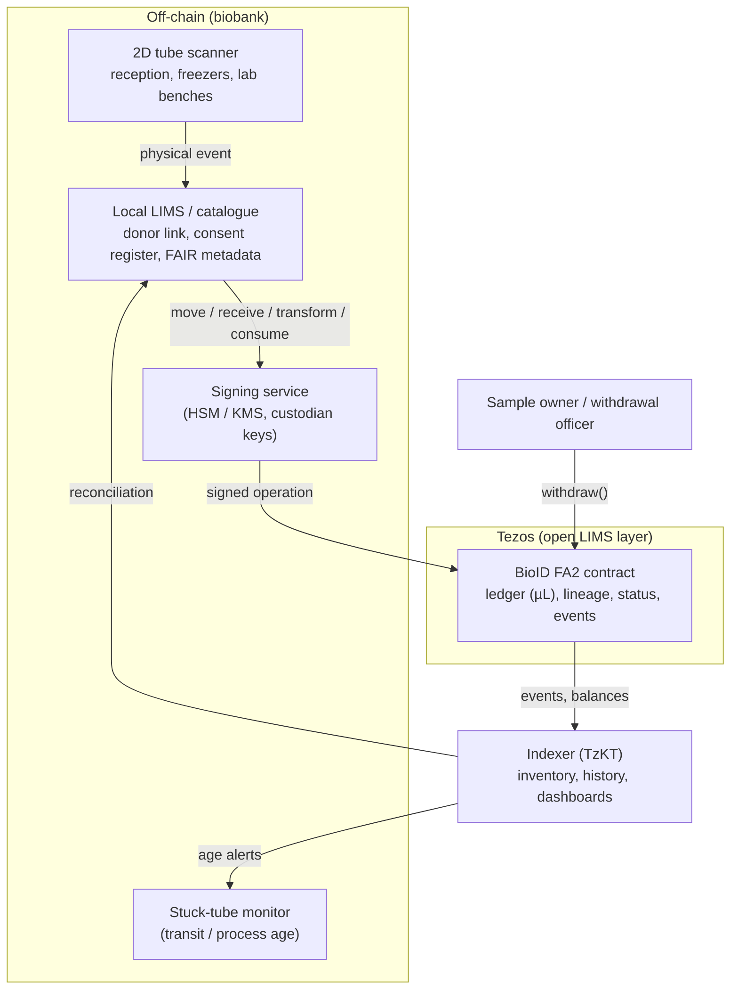

# BioID

BioID is an open recipe for tamper-evident biobank sample tracing that any biobank can adapt. One FA2 token stands for one tube. The balance is the volume left, in µL. Parent links record lineage. Wallets stand for storage, processes and shipments. Consent withdrawal freezes a lineage, then burns a tube only after it is physically destroyed.

**Status: Shadownet testnet demo, synthetic data only.** The phone viewer reads the public demo contract. Mainnet is not in use.

**[Core operating principles](principles.md)** for any ecosystem that adopts the recipe: no personal data on-chain, the ledger follows the physical tube, every holding wallet is registered and typed, and a hand-over between sites is a ship followed by a receive. Wallets should have a readable Tezos Domains name. The type rules are in [Wallet types](wallet-types.md).

## Read

- [White paper v0.3](whitepaper/BioID-whitepaper-v0.3.md) — draft for community feedback and potential adopters ([Word](whitepaper/BioID-whitepaper-v0.3.docx), [PDF](whitepaper/BioID-whitepaper-v0.3.pdf))

- [Core operating principles](principles.md) — rules for an ecosystem that adopts the recipe
- [Wallet types](wallet-types.md) — vocabulary, transition matrix, burns, and how a registry is anchored
- [LIMS integration](lims-integration.md) — how an existing LIMS stays the system of record, and a bridge maps its events onto the chain
- [FA2 contract](../contracts/README.md) — SmartPy multi-asset contract, and the [synthetic public demo](../pilot/README.md) a visitor can replay
- [Phone viewer](viewer.md) — static page that scans a tube code and reads volume, custody, lineage, and datasets
- [Concept note](concept-note.md) — design, worked example, open questions ([PDF](pdf/concept-note.pdf))
- [Argumentation](argumentation.md) — why an open chain-of-custody layer, with sources ([PDF](pdf/argumentation.pdf))

The notes on this site are the same Markdown files as in the repository. GitHub renders their Mermaid diagrams when you read the files there. This page loads Mermaid in the browser so the diagram above renders on GitHub Pages too.

Code in the repository is MIT. These pages are [CC BY 4.0](https://creativecommons.org/licenses/by/4.0/).

## Support

Tips in tez are welcome. Send them to `bioid.tez`, which resolves to `tz1Tm5drMq3zueTpSonJ2FE7P3MBZN9RBNta`. [View the address on TzKT](https://tzkt.io/tz1Tm5drMq3zueTpSonJ2FE7P3MBZN9RBNta).

Send only on Tezos mainnet, and double-check the address in your wallet. Most Tezos wallets accept `bioid.tez` directly. Tips are voluntary. They fund development and hosting. There are no perks.
