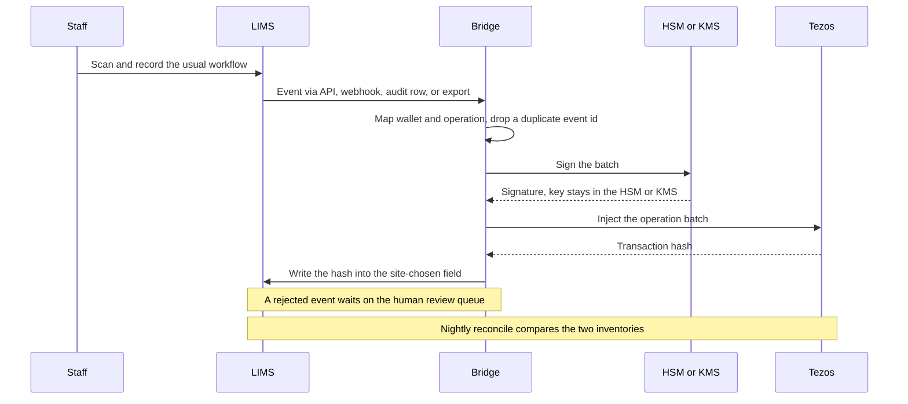

# LIMS integration

How a laboratory's existing LIMS keeps running, and a bridge beside it mirrors tube events onto BioID.

Early concept. Nothing is deployed. The event feed, location codes and wallet labels in this note are synthetic. The bridge is a reference implementation, not a service to install in a lab.

Staff keep the LIMS they already have. The LIMS stays the system of record for consent, identity and the day-to-day inventory the laboratory trusts. The chain is a second book for custody, volume and lineage. People do not learn a new screen for this.

## What the bridge does

A bridge service is the only new component. It consumes events the LIMS already produces and turns each one into an on-chain operation, using the [move-or-mint rule](wallet-types.md#move-or-mint) and the [wallet-type matrix](wallet-types.md#3-allowed-transitions).

How those events leave the LIMS depends on the product the laboratory already runs. Some products offer a documented HTTP API. Some can call a webhook. Some keep an audit log or a change table a reader can poll. Some can write a scheduled file export. A site uses whichever of those its vendor actually documents. This recipe does not claim that any named LIMS product supports a particular one of them.

The bridge then:

1. Maps the LIMS storage location to a registered holding wallet, and the LIMS event type to one operation.
2. Checks that operation against the wallet-type rules. A location change of the same tube is a MOVE or a SHIP or a RECEIVE of the existing token. A new container is a MINT of a new token plus a BURN of only the volume taken. Volume used up is a BURN. A measurement correction is an ADJUST.
3. Batches the operations, asks the custodian's HSM or cloud KMS to sign, and submits the batch.
4. Writes the transaction hash back into a field the site chooses on the LIMS record (a custom field such as `bioid_tx` is enough; that name is not a standard LIMS column).
5. Skips an event whose id it has already applied, and puts an event it cannot apply onto a human review queue.

The tube's 2D code is the token id. `SY00000107` in the LIMS and `SY00000107` on the chain are the same tube. The bridge does not invent a second identifier.

## Mapping

Locations in the LIMS are whatever codes that laboratory already uses. Each code points at one label in the published [wallet registry](wallet-types.md). The synthetic mapping for the worked example is [`examples/lims-mapping.example.json`](../examples/lims-mapping.example.json) (the same table is also in YAML).

| LIMS location code | Registered wallet | Type |
|---|---|---|
| `RECEPTION` | `SYN-INTAKE` | `INTAKE` |
| `FRZ-LT80` | `SYN-FRZ-LT80` | `STORAGE` |
| `FRZ-BIOS` | `SYN-FRZ-BIOS` | `STORAGE` |
| `PROC-ALIQ` | `SYN-PROC-ALIQ` | `PROCESS` |
| `PROC-RNA` | `SYN-PROC-RNA` | `PROCESS` |
| `PROC-DNA` | `SYN-PROC-DNA` | `PROCESS` |
| `PROC-SEQ` | `SYN-PROC-SEQ` | `PROCESS` |
| `COURIER` | `SYN-TRANSIT-COURIER` | `TRANSIT` |

| LIMS event | Chain operation | What it means |
|---|---|---|
| `collected` | **MINT** (`mint_primary`, reason `collected`) | A new primary tube. Lands in `INTAKE` or `TRANSIT` only. |
| `received` | **RECEIVE** (reason `received`) | The destination custodian accepts a tube out of `TRANSIT`. |
| `stored`, `moved`, `to_process` | **MOVE** (reasons `stored`, `moved`, `to_process`) | The same tube changes place. The balance moves with it. |
| `shipped` | **SHIP** (a MOVE with reason `shipped`) | The same tube enters `TRANSIT`. Sites may differ. |
| `aliquoted`, `split`, `rna_isolation`, `dna_isolation` | **MINT** of each child and **BURN** of only `burn_uL` on the parent | A new container. The parent token continues with the remainder, including zero. |
| `consumed` | **BURN** (reason `consumed`) | Volume used up. The token continues with what is left. On an `EXTERNAL_USER` wallet the chain entrypoint is `report_use`, not `consume`. |
| `measured` | **ADJUST** (reason `measured`) | The measured volume replaces the nominal volume. Same token. |
| `retrieval` | **MOVE** (reason `retrieval`) | Pick a stored tube into the retrieval `PROCESS` wallet. |
| `data_attached` | **DATA** (`attach_data`, reason `data_attached`) | A URI, content hash and data type recorded against the tube. No balance change. |
| `access_requested` | **ACCESS_REQUEST** | An opaque agreement reference, its hash, and DUO codes. No personal data. |
| `access_approved` | **ACCESS_APPROVE** | The holding custodian approves one request. A retrieval ship needs this first. |

A site publishes the event names its LIMS actually emits and the reason codes from [Wallet types](wallet-types.md#6-reason-code-vocabulary). Unknown location codes and unknown event types wait for a person; the bridge does not guess a wallet.

## Signing, batching, retries

Custodian keys stay in an HSM or a cloud KMS. The bridge holds a key reference (for example `kms://alias/syn-custodian-lab`), asks that service to sign, and never sees the key bytes. Keys are not committed to this repository. The reference process has no key material in it.

Tezos accepts several operations in one injection. The bridge groups a bounded number of already-validated events into one batch so a busy freezer does not become one transaction per scan. The reference ledger records a batch hash. A real deployment would write the chain transaction hash into the LIMS field.

A transient failure (a timeout, a refused connection) is retried a small number of times. The idempotency key is the LIMS event id, stored with the balance change. A retry after a successful commit does not mint or move the tube again. A rule violation is not retried: it goes to the review queue with the reason, and the rest of the batch is applied one event at a time so one bad scan does not hold up the others.

## Reconciliation

Once a night the bridge compares a LIMS inventory snapshot with the balances in each holding wallet. The report lists tubes whose wallet, volume, or presence differs. Zero-balance tokens may be absent from a physical inventory; the comparison treats a positive balance on only one side as a mismatch.

The synthetic snapshot [`examples/lims-inventory.example.json`](../examples/lims-inventory.example.json) matches the example feed except for one deliberate row: `SY00000106` is filed under `FRZ-LT80` in the snapshot and sits in `SYN-FRZ-BIOS` on the ledger. The reconcile command prints that one mismatch. A real report is for a person to clear in the LIMS or with a correcting event. The bridge does not silently rewrite either book.

## Exceptions and review

Events that fail the matrix, name an unknown location, or still fail after the retries are stored on a review queue with the LIMS payload and the reason. They are not marked as processed, so a corrected replay can apply them later. Typical cases:

- Aliquoting while the tube is still on intake. Transform is allowed only in a `PROCESS` wallet, after a MOVE with reason `to_process`.
- Shipping straight out of a process wallet. The tube is stored or quarantined first, then shipped.
- A `from_location` that is not where the ledger says the tube is.
- A burn larger than the remaining balance.

Someone looks at the queue. The chain is not updated until the event is valid.

## Rollout

Start in shadow mode. Pick one freezer and one workflow. Run the bridge against a public testnet, with synthetic codes until the site is ready, and keep the LIMS as the record staff act on. Each night, compare the two inventories. When the mismatch report for that freezer and that workflow is understood, widen to the next workflow. Principle 11 still applies: tests use a testnet and synthetic data.

## Security and data protection

Only pseudonymous codes leave the LIMS: tube ids, location codes, event ids, volumes, sample-type words, and an opaque `consent_ref` such as the synthetic `cref-a1b2c3`. The bridge must not receive names, dates of birth, clinical notes, or the table that links a person to a consent reference. That mapping stays in the consent register, where it can be deleted ([principle 1](principles.md)).

Transaction hashes written back are hashes, not copies of the payload. Bridge logs should keep the same limit. A public chain is the wrong place for a free-text LIMS comment, so the translator ignores fields it was not mapped to send.

The reference Tezos backend reads `TEZOS_RPC_URL`, `TEZOS_CONTRACT`, `TEZOS_KEY_REF` and `TEZOS_NETWORK` from the environment. It refuses a mainnet network name and a mainnet RPC URL. It refuses a raw secret key. It also refuses to submit at all until the FA2 contract exists under `contracts/`. The default backend is an offline ledger, so the example feed runs with no network and no key.

## Sequence

## Worked example, adapted to the rules

[`examples/lims-events.example.jsonl`](../examples/lims-events.example.jsonl) replays the blood-sample story in the [concept note](concept-note.md): receive, aliquot, store, move into the lab processes, split, RNA isolation, DNA isolation, sequencing consumption, ship, receive. Codes are the synthetic `SY000001xx` series. Wallets are the synthetic registry.

Two steps differ from the concept-note table, because the [transition matrix](wallet-types.md#3-allowed-transitions) rejects them:

- Aliquoting happens in `SYN-PROC-ALIQ`, after a MOVE with reason `to_process`. Intake cannot transform.
- A process wallet cannot ship. After sequencing, `SY00000107` is stored in `SYN-FRZ-LT80`, shipped to `SYN-TRANSIT-COURIER`, and received back into `SYN-FRZ-LT80`. That is the two-step hand-over on this token. A site that has a separate bench `STORAGE` wallet would ship from that bench to the destination and would not send the tube out and back.

End state of the positive balances: `SY00000102` 1000 µL in `SYN-FRZ-LT80`, `SY00000106` 100 µL in `SYN-FRZ-BIOS`, `SY00000107` 150 µL in `SYN-FRZ-LT80`. Parents that gave up all their volume remain, at 0 µL.

The Python package that replays this feed, prints history and inventory, and runs the reconcile is [`bridge/README.md`](../bridge/README.md).
