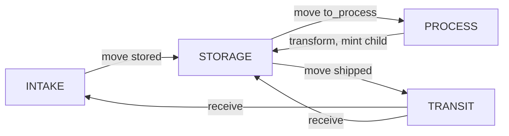

# Wallet types

Rules for what kind of thing a holding wallet is, which operations it allows, and how an ecosystem publishes its registry. These rules carry out the [core operating principles](principles.md), in particular principles 3, 4, 5, 6, 7 and 9.

Early concept. Nothing is deployed. Names, addresses and dwell times below are synthetic.

The concept note introduces wallets as places and processes, not people. This note is the controlled vocabulary for that idea. Where it tightens the concept note, it says so.

## 1. What is, and is not, a wallet

A **holding wallet** is an address that may hold tube tokens. It stands for a place or a step: a freezer, a reception bench, an isolation protocol, a courier bag, a quarantine shelf. The whole balance of a tube sits in one holding wallet, because the tube is in one place.

An **owner** is not a holding wallet. Ownership lives in the owner registry, `owner : big_map(root_id, address)`, one row per root sample. Every descendant inherits that owner through `root_id`. The owner can withdraw the lineage. They do not hold the tubes, so a withdrawal can freeze material that is physically in a freezer without pretending the owner is the freezer.

A **custodian** is not a holding wallet either. A custodian is the organisation whose signer keys may act on a set of holding wallets. Those keys authorise a move or a receive. They do not appear as the FA2 balance holder. If they did, "who may sign" and "where the tube is" would be the same fact, and a key rotation would look like a shipment.

People do not hold tokens. The chain would otherwise publish a person as a location.

## Move or mint?

A location change and a new tube are different facts. Mixing them up destroys the journey the token is there to record.

| What happened | What the chain does |
|---|---|
| The same physical tube changes place (storage, intake, process, transit, quarantine) | **MOVE** that same token: an FA2 transfer of its balance, with a reason code. Do not mint. Do not burn. The token's transfer history is the tamper-evident journey. |
| A new physical container appears (a daughter tube from aliquoting, an extract from DNA or RNA isolation, a library, and so on) | **MINT** a new token with `parent_id`. **BURN** only the volume actually taken from the parent. The parent token continues, with whatever volume remains. |
| Material is used up (for example 50 µL into sequencing), or it is destroyed or lost | **BURN** that amount, with a reason code. |
| Measured volume differs from the nominal volume | `adjust_volume`. No mint. |

Each new tube has its own 2D code. Scanning that code shows that tube's own transfers, plus the parent link back to where the volume came from. Scanning the parent still shows the parent's own journey, including the transfers from before the child existed.

Taking the whole remaining volume is still this rule: burn that volume, and the parent token continues at 0 µL. It is not replaced by the child, and it is not deleted to record a move.

## 2. Controlled vocabulary

Six types. An ecosystem MUST use these spellings on-chain and in the registry. Unknown spellings are rejected until a new vocabulary version adds them (see §10).

| Type | What it is | What it may hold | Operations |
|---|---|---|---|
| `STORAGE` | A physical resting place: freezer, fridge, LN2 tank, or a rack or box inside one, linked by `parent_location`. A bench that only holds tubes, and does not transform them, is `STORAGE` too. | Tubes at rest, including long-term inventory. | Inbound `move` and `receive`. No transform. No consume-for-use. |
| `INTAKE` | Arrival: registration of new material and recording of measured volume. The concept note's reception wallet is this type, not long-term storage. | Tubes just arrived, until they are stored, sent to a process, shipped, or rejected. | `mint_primary` may land here. `adjust_volume` on measurement. No transform. No consume-for-use. |
| `PROCESS` | One lab step: aliquoting, split, RNA isolation, DNA isolation, sequencing, or a later step the ecosystem adds. | Tubes while that step is underway. | The only type where `transform` and consume-for-use are allowed. Tubes SHOULD NOT dwell past `expected_max_dwell`. |
| `TRANSIT` | A courier or other shipment between sites. | Tubes that have left and have not been received. | Enter only by `mint_primary` (collected straight into a shipment) or by `move` with reason `shipped`. Leave only by `receive`, or by the loss exception in §5. No transform. No consume-for-use. |
| `QUARANTINE` | Optional hold: a deviation, a QC hold, or a shelf used to gather tubes after withdrawal. | Tubes that must not be worked on. | Inbound `move` and `receive`. No transform. No consume-for-use. Release is a `move` back to `STORAGE` or `INTAKE` at the same site, and only when the token is not frozen or stopped. |
| `EXTERNAL_USER` | A recipient outside the sending lab, after an approved access request. The wallet holds the tube for the agreed use. It is not a second freezer of the sender. | Tubes released under an access agreement. | `receive` from `TRANSIT` only when that tube has an approved request and this wallet's custodian is the requester. `report_use` records use, return, or destruction. `attach_data` records a result. No `mint_primary`. No `transform`. |

`PROCESS` and `TRANSIT` carry `expected_max_dwell`, an ISO 8601 duration, as metadata. The contract does not revert when the duration is exceeded: a long isolation is still a real isolation. An off-chain monitor SHOULD flag dwell past the published maximum. The durations in the example registry are illustrations, not recommended SOPs.

Token status is not a wallet type. `withdraw` freezes a tube where it sits. An ecosystem MAY also move a tube into `QUARANTINE` before withdrawal, but it does not have to. A frozen or stopped tube cannot be moved in order to freeze it.

### Relation to the concept note's four kinds

| Concept note | This vocabulary |
|---|---|
| Storage, including `BB-RECEPTION` | `BB-RECEPTION` is `INTAKE`. Freezers are `STORAGE`. |
| Lab / bench | A bench that only holds tubes is `STORAGE`. The work is a `PROCESS` wallet. |
| Process | `PROCESS` |
| Transit | `TRANSIT` |
| (no separate kind) | `QUARANTINE`, optional |

The worked example aliquots at reception. Under these rules that transform runs in a `PROCESS` wallet, after a `move` with reason `to_process`, not in `INTAKE`.

## 3. Allowed transitions

Same site means the `site` string of the source wallet equals the `site` string of the destination. A cross-site jump that is not ship-then-receive MUST be rejected.

Signer means a key of the custodian registered on that wallet, unless the row says otherwise. The owner does not sign ordinary custody. The owner, or a delegated withdrawal role, signs `withdraw`. `confirm_destroyed` may be signed by the holding custodian or by that withdrawal role.

| From | To | Operation | Reason | Who signs |
|---|---|---|---|---|
| — | `INTAKE` | `mint_primary` | `collected` | Custodian of that intake wallet |
| — | `TRANSIT` | `mint_primary` | `collected` | Custodian of that transit wallet |
| `INTAKE` | `STORAGE` | `move` | `stored` | Source custodian. Same site. |
| `INTAKE` | `PROCESS` | `move` | `to_process` | Source custodian. Same site. |
| `INTAKE` | `QUARANTINE` | `move` | `qc_hold` | Source custodian. Same site. |
| `INTAKE` | `TRANSIT` | `move` | `shipped` | Source custodian. Sites may differ. |
| `STORAGE` | `STORAGE` | `move` | `stored`, `moved`, `thawed` | Source custodian. Same site. This includes a move onto a rack or box wallet. |
| `STORAGE` | `PROCESS` | `move` | `to_process`, `retrieval` | Source custodian. Same site. `retrieval` is the pick from storage for an approved external use. |
| `STORAGE` | `QUARANTINE` | `move` | `qc_hold` | Source custodian. Same site. |
| `STORAGE` | `TRANSIT` | `move` | `shipped` | Source custodian. Sites may differ. |
| `PROCESS` | `PROCESS` | `move` | `moved` | Source custodian. Same site. |
| `PROCESS` | `STORAGE` | `move` | `stored` | Source custodian. Same site. Used when the same tube is put away. |
| `PROCESS` | `QUARANTINE` | `move` | `qc_hold` | Source custodian. Same site. |
| `QUARANTINE` | `STORAGE` | `move` | `released` | Source custodian. Same site. Rejected when the token is frozen or stopped. |
| `QUARANTINE` | `INTAKE` | `move` | `released` | Source custodian. Same site. Rejected when the token is frozen or stopped. |
| `QUARANTINE` | `TRANSIT` | `move` | `shipped` | Source custodian. Rejected when the token is frozen or stopped. |
| `TRANSIT` | `STORAGE` | `receive` | `received` | **Destination** custodian, not the sender. |
| `TRANSIT` | `INTAKE` | `receive` | `received` | Destination custodian. |
| `TRANSIT` | `QUARANTINE` | `receive` | `received` | Destination custodian. |
| `PROCESS` whose process code is `retrieval` | `TRANSIT` | `ship` | `shipped` | Source custodian, and only when that tube has an approved access request. Any other `PROCESS` to `TRANSIT` is rejected. |
| `PROCESS` | `STORAGE` or `PROCESS` | `transform` | `aliquoted`, `split`, `rna_isolation`, `dna_isolation`, or a published extension | Process custodian. Every input wallet is `PROCESS`. Every output wallet is `STORAGE` or `PROCESS` and the same site as the process. |
| `PROCESS` | — | `consume` | `consumed`, `discarded` | Process custodian. |
| `TRANSIT` | `EXTERNAL_USER` | `receive` | `received` | Destination custodian, who must be the approved requester. |
| `EXTERNAL_USER` | `TRANSIT` | `ship` | `shipped` | Recipient custodian. This is the return path (`report_use` action `returned`). |
| `EXTERNAL_USER` | — | `report_use` | `consumed`, `discarded` | Recipient custodian. `consumed` burns the stated volume. Destruction burns the remainder with reason `discarded`. |

Not in the table, and therefore rejected:

- `move` out of `TRANSIT` (only `receive`, or the loss burn in §5).
- `receive` into `PROCESS` or into `TRANSIT`. Arrival is recorded first; a later `move` sends the tube to the bench.
- `move` from `PROCESS` straight into `TRANSIT`, except the `retrieval` row above. Put the tube into `STORAGE` or `QUARANTINE`, then ship, unless it is a retrieval for an approved external use.
- Any `move` between different sites except the `shipped` rows.
- `mint_primary` into `STORAGE`, `PROCESS` or `QUARANTINE`.
- `transform` or consume-for-use anywhere except `PROCESS`.

`adjust_volume` is not a transition and it does not mint. It is allowed on `INTAKE` and `STORAGE`, with a published reason such as `measured`, `evaporation` or `dead_volume`. It is rejected on `TRANSIT`. A place change is a `move` or a `receive` of the same token. See [Move or mint?](#move-or-mint).



## 4. Who may edit the registry

Creating a wallet, and setting `type`, `site`, `parent_location`, `custodian` and `active`, is an admin operation (the concept note's admin multisig). A custodian MUST NOT change their own type.

A custodian MAY update `label`, `metadata_uri`, and the recorded Tezos Domains name for a wallet they already operate. They cannot point the name at a different address than the registry row.

`active: false` rejects `mint_primary`, `receive` and any inbound `move`. Outbound `move`, `shipped` and `confirm_destroyed` still succeed, so a retired freezer can be emptied. `transform` and consume-for-use are rejected while the wallet is inactive.

## 5. Burns

Burning is how a balance stops claiming that material still exists. The reason says why.

| Reason | Where | Meaning |
|---|---|---|
| Input burn inside `transform` | `PROCESS` only | Only the volume taken from the parent is burned. The parent token continues with the remainder, which may be zero. Each new container is a new token with `parent_id`. |
| `consumed` | `PROCESS`, or `EXTERNAL_USER` via `report_use` | Volume was used in an assay, including sequencing, or by the approved recipient. |
| `discarded` | `PROCESS`, `INTAKE` when the tube is rejected on arrival, `QUARANTINE`, or `EXTERNAL_USER` via `report_use` | The material was thrown away, or the prep failed, or the recipient destroyed it. |
| `lost` | Any holding type, including `TRANSIT` and `STORAGE` | The tube cannot be found. This is a deviation, not a use. On `TRANSIT` it is the only way out other than `receive`, so a shipment that never arrives can be closed. The event SHOULD carry a `ref_hash` of the deviation record. |
| `withdrawn-destroyed` via `confirm_destroyed` | Any holding type | The token is frozen, and someone has confirmed physical destruction. Allowed in every type because a frozen tube cannot be moved to a `PROCESS` wallet first. |

`STORAGE` and `TRANSIT` have no consume-for-use and no transform. The `lost` and `withdrawn-destroyed` rows are the exceptions, and they exist so the book can catch up with a tube that is already gone.

## 6. Reason-code vocabulary

Starter list. An ecosystem MUST publish the list it actually accepts. It MAY add codes. It MUST NOT reuse a code above for a different meaning. The contract SHOULD reject a code that is not in the published list.

- Move and ship: `collected`, `stored`, `moved`, `thawed`, `to_process`, `retrieval`, `qc_hold`, `released`, `shipped`
- Receive: `received`
- Transform: `aliquoted`, `split`, `rna_isolation`, `dna_isolation`
- Consume and other burns: `consumed`, `discarded`, `lost`, `withdrawn-destroyed`
- Volume adjustment: `measured`, `evaporation`, `dead_volume`

Mapping of this list onto ISO 20387 records or an ontology such as OBI: mapping to be confirmed.

## 7. Names

- `label` is stable, uppercase, hyphenated: `SYN-FRZ-LT80`, `SYN-PROC-RNA`. It is the name that appears in logs.
- `site` is a short id for a campus or a courier operation, not a postal address and not coordinates.
- `parent_location` is the address of another `STORAGE` wallet. A freezer has no parent. A rack or box names the freezer (or the rack) it sits in. The slot inside a box stays in the LIMS, as in the concept note, unless an ecosystem chooses to register a wallet per slot.
- A Tezos Domains name SHOULD be recorded, per [principle 4](principles.md). Pattern for the example ecosystem: `bios.example.tez`. The name SHOULD resolve to the wallet address once it is really registered. Until then the registry field is only a declaration.

This repository's names under `example.tez` are placeholders. They are not registered. They must not be read as this recipe's production names.

## 8. How the contract enforces types

Holding wallets have no private keys of their own. The contract keeps a registry:

```
wallet_registry : big_map address {
  type : storage | intake | process | transit | quarantine | external_user
  label : string
  site : string
  parent_location : option address
  custodian : address          // organisation multisig, not a person
  active : bool
  metadata_uri : string        // off-chain registry or fragment
  process : string             // retrieval is what allows a PROCESS wallet to ship
}
```

Only the admin role writes `type`, `site`, `parent_location`, `custodian` and `active`. Credits (`mint_primary`, `move`, `receive`, transform outputs) MUST fail when the destination is missing, inactive, or the wrong type for that operation. Debits that burn or ship MUST fail when the source type does not allow the operation in §3 and §5.

The reference contract disables the standard FA2 `transfer` entrypoint. A bare transfer cannot carry a reason without changing the TZIP-12 parameter, so custody moves go through `move`, `ship` and `receive`. `balance_of` and `update_operators` stay. An operator still cannot move a tube.

`attach_data` may be called by the custodian of the wallet that holds the tube, or by the external recipient recorded when the tube was received into `EXTERNAL_USER`. The argument is a URI (`https://` or `ipfs://`), a 32-byte content hash, a data type, the step it belongs to, and optional licence and access level. The same record may be passed with `move`, `transform`, `consume`, `ship` and `receive`. The chain stores the reference, not the file. A viewer walks `parent_id`, so a child tube shows datasets recorded on its ancestors. The URI must point at an access-controlled or open resource. It MUST NOT point at personal data.

The on-chain row is the enforcement copy. The JSON registry in the next section is the published copy humans and indexers read. They match when the anchor hash matches the bytes.

`expected_max_dwell`, the Tezos Domains name, storage temperature and the process code live in the JSON document the `metadata_uri` points at. They are not required as separate Michelson fields. A contract MAY also store the domains name on-chain; it MUST still reject a type error without relying on the name.

## 9. Registry file, and why this repository is not a registry

The format is [JSON Schema](../schemas/wallet-registry.schema.json), draft 2020-12. A synthetic ecosystem that exercises every core type is [examples/wallet-registry.example.json](../examples/wallet-registry.example.json).

This recipe repository holds the format and that synthetic example only. A real ecosystem publishes its own registry elsewhere and anchors it:

- **TZIP-16.** Contract storage includes `big_map %metadata string bytes`. The value at the empty key `""` is a URI. TZIP-16's `sha256` URI scheme binds the hash of the bytes to their location: `sha256://0x` plus 64 hex digits, then `/`, then the percent-encoded registry URI. A compliant parser ignores extra top-level metadata fields, so an ecosystem MAY add its own field whose value is that URI. Checked against the TZIP-16 text in the Tezos TZIP repository.
- **Tezos Domains.** Each holding wallet SHOULD have a name in the registry, and the registered name SHOULD resolve to that wallet's address. A name that resolves somewhere else is a publishing error, not a second freezer.

A file that is not anchored can claim to be any freezer. Readers SHOULD trust a registry when the hash in contract metadata matches the bytes they fetched, and SHOULD treat a matching Tezos Domains name as a convenience, not as the root of trust.

## 10. Extensibility

Vocabulary id for this document: `bioid-wallet-types-2`. Version 1 had the five types above except `EXTERNAL_USER`. A registry that only uses those five types can keep the id `bioid-wallet-types-1`. A registry that uses `EXTERNAL_USER` or the `retrieval` process code uses version 2.

- New types need a new vocabulary id, a new matrix, and a contract change. Until that change, unknown types MUST be rejected. `EXTERNAL_USER` is that change for version 2.
- New reason codes and new `process` codes can be added by publishing them. `process` value `other` is the escape hatch and SHOULD carry a note in metadata.
- Extra metadata keys are allowed. They MUST NOT be required for the transition checks in §3.
- `parent_location` already covers rack and box without a new type.

## 11. Mapping to existing standards

Checked on 19 October 2026 against the public pages linked here. Anything not on those pages is marked mapping to be confirmed, rather than inferred.

| Topic | What was verified | What this rulebook does not claim |
|---|---|---|
| Long-term storage temperature | [MIABIS](https://miabis.bbmri-eric.eu/Sample+Donor+Event/V1.1/Data-describing-Sample.html) attribute `MIABIS-SAMPLE-03` Sample storage temperature: the long-term temperature after preparation, "based on SPREC v4 and MIABIS-COLLECTION-15". Allowed values include `RT (Room temperature)`, `2 °C to 10°C`, `-18 °C to -35 °C`, `-60 °C to -85 °C`, `<-135 °C`, `Liquid nitrogen vapor-phase`, `Liquid nitrogen liquid-phase`, `Other`. | MIABIS defines no wallet type and no freezer-versus-fridge code. Mapping of `storage_kind` to a MIABIS field: mapping to be confirmed. Mapping of these temperature strings onto SPREC codes: mapping to be confirmed. The MIABIS page is the source for the strings; this note did not re-read SPREC. |
| Where a container sits | [FHIR R5 Specimen](https://hl7.org/fhir/R5/specimen.html) `container` is the "Direct container of specimen (tube/slide, etc.)", with a required `device`. `container.location` is `Reference(Location)`, "Where the container is". The same page says the resource does not track a container inside its parent container, such as a tube in a rack in a freezer. | The wallet is not `Specimen.container`. The container is the tube, which is the token. A `STORAGE` wallet MAY be projected to `container.location`. The identifier profile for that Location, and any profile for `parent_location`: mapping to be confirmed. |
| Processing step | FHIR R5 `Specimen.processing` is "Processing and processing step details", with `description`, `method` (example binding Specimen Processing Method) and `time[x]`. | A `PROCESS` wallet is the place the step happens. Its process code MAY be copied into `Specimen.processing.method` by a LIMS adapter. Mapping of `aliquoted`, `rna_isolation`, `dna_isolation` and `sequencing` onto a particular code system: mapping to be confirmed. |
| Collection | FHIR R5 `Specimen.collection` is "Collection details" (how the specimen was obtained). | `INTAKE` is reception and registration, which is later than collection. Mapping of `INTAKE` to `Specimen.collection`: mapping to be confirmed. Collection details stay off-chain. |
| Transit and quarantine | — | No MIABIS sample attribute and no FHIR Specimen field checked here names a courier wallet or a quarantine wallet. Mapping to be confirmed. |
| ISO 20387 storage and processing terms | The concept note and the argumentation cite ISO 20387:2018 for traceability and transport chain of custody, from the public abstract, circulated extracts and assessor checklists, not from a licensed full text read for this rulebook. | Equating each wallet type with a specific ISO clause or defined term: mapping to be confirmed. |

`TRANSIT` plus `receive` is this recipe's response to a two-party transport hand-over. That is a design claim, not a claim that ISO 20387 uses the word wallet.
