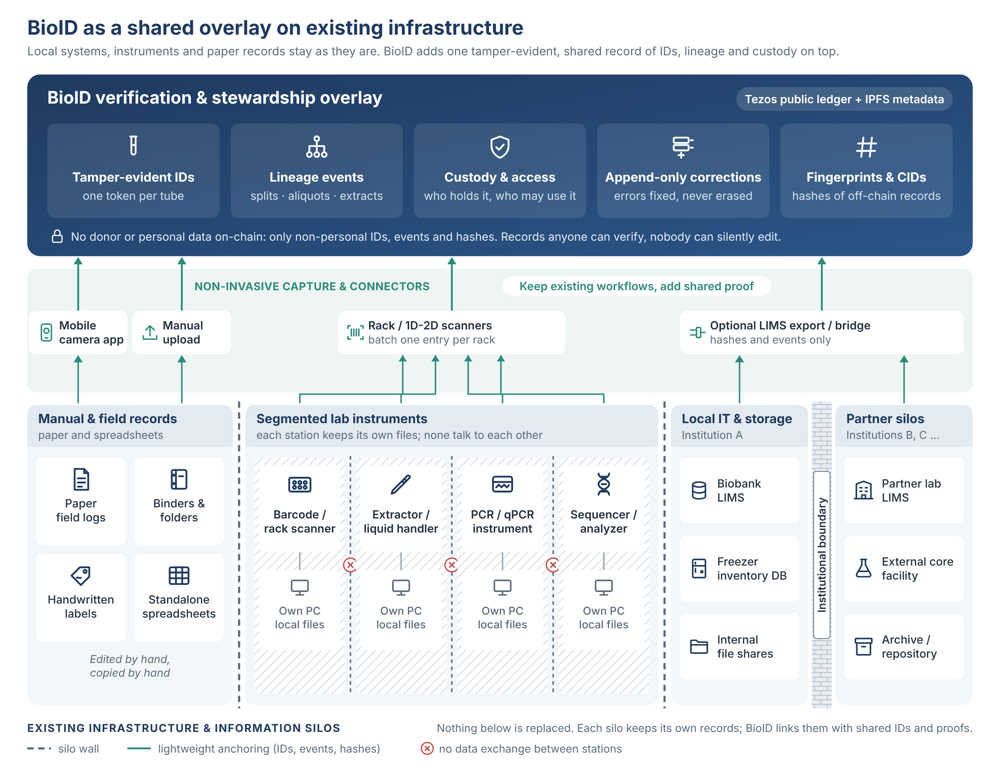
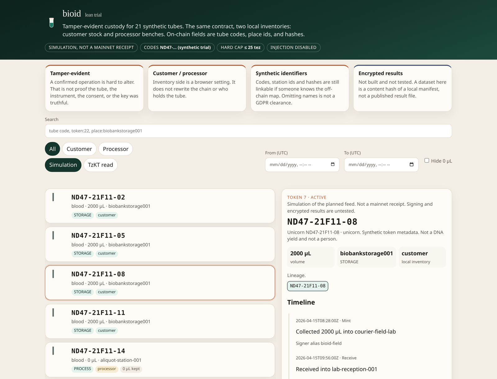

# BioID: Tamper-Evident Provenance, Consent and Distributed Stewardship for Biobank Samples on Tezos

**A white paper by the BioID project (bioid-web), version 0.3**

*Draft for community feedback and potential adopters, November 2026. All sample, volunteer and wallet data described here is synthetic.*

## 1. Abstract

Biobanks keep physical samples, such as blood, tissue, fecal samples, cells or other material, and the DNA extracted from them, together with metadata records of where each sample came from, who has handled it and how, what the donor agreed to and who is responsible for it. These records usually sit in separate, editable databases run by individual institutions. When trust in institutions is under strain — from the political climate, growing economic challenges, industry competition, forgery (simple or sophisticated), or the implications of AI/SI agents and the potential for even more sophisticated manipulation by participants in this ecosystem — institutions that hold records may need a further, transparent record. That record should be accessible without depending on any one institution's software, should be tamper-resistant, and should provide a long-term account of collection entries.

BioID adds a layer of trust infrastructure, using advanced mathematics and a public ledger. It records and mirrors the lifecycle of each physical tube as a token on a public blockchain. Each tube is represented as one token, its balance is its volume in microlitres (or grammes), its parent and child tubes are linked on-chain, and every handling step emits a public event. Anyone can check the record, now or decades from now, even if the institution that wrote it no longer exists. Only non-personal identifiers and fingerprints go on-chain, keeping personal data off the records.

In November 2026 we ran a mainnet trial with synthetic data. 21 field tubes became 50 tokens, and 92 business events were executed as 108 on-chain operations, at a total cost of 20.87 tez (about USD 5.23 at the 10 November 2026 price of USD 0.2507 per tez). This paper describes the initial design idea, reports the trial we performed, and separates what was implemented from what is still future work. It ends by inviting feedback and outlining how an adopter could run a pilot.

## 2. The problem: trust in sample records

### 2.1 Provenance in silos

A sample's value depends on its history: collection, processing, storage and every transfer in between. Biobankers call this *provenance*, and the documented sequence of handovers the *chain of custody*. In most settings that history is spread across a field sheet, a laboratory information management system (LIMS), a freezer inventory and a sharing agreement. Each is controlled by one organisation and can be edited by its administrators. Audit trails exist, but they sit inside the systems they audit.

### 2.2 When institutional trust erodes

That model works as long as everyone trusts the operator. It is weaker when funding or political priorities shift, when competing companies or institutions start to doubt each other's records, or if trust is lost after someone forges records. An independent, append-only record, open to anyone to inspect, exists independently of any institutional information system. It does not replace institutional quality systems. It gives them a platform for evidence that does not depend on trusting any single party, and that can survive if personnel rotate, laboratory information systems fail, or, in the worst case, the recording institution closes entirely.

### 2.3 Consent and distributed stewardship

According to most biobank management practices, donors can withdraw consent at any time, and for this to be executed correctly, a withdrawal request has to reach every derived tube. This means that splits, DNA and extracts, wherever they are stored, would need to be flagged and removed. Meanwhile collections are increasingly built by networks of field teams, laboratories, biorepositories and different research projects. We call shared responsibility for samples and data *distributed stewardship*. This means managing samples and data on behalf of donors and contributors to science, not owning property. Without a common, neutral record, stewardship that crosses organisations needs bilateral agreements and manual reconciliation.

## 3. The BioID approach

BioID does not replace anything a biobank already uses. Field sheets, binders, standalone instruments with their own PCs, the LIMS, freezer inventories and partner systems all keep their own records as before. BioID sits on top of them as one shared, tamper-evident layer. Existing records are anchored to it through scanners, a phone camera, manual upload or an optional LIMS export, and only non-personal IDs, events and fingerprints go up. The silos stay where they are, but their records can now be checked against a common history.

**Figure 1. BioID as a shared overlay on existing infrastructure, instruments and manual records.**



### 3.1 Two short primers

**For biobank readers.** A *blockchain* is a ledger copied across many independent computers. Changing an accepted record would mean overriding the network, so the history is *tamper-evident*. A *smart contract* is a program on the chain that defines the allowed actions. A *token* is an entry in a contract with a holder and a balance; *FA2* (TZIP-12) is the Tezos token standard. A *wallet* is an address controlled by a cryptographic key. An *event* is a structured public message emitted by a contract. *IPFS* is a file network where a file's address is derived from its content. *tez* pays network fees.

**For Web3 readers.** A *biobank* is an organised collection of biological samples plus associated data. An *aliquot* is a portion split into its own tube. An *extract* is material, here DNA, isolated by a laboratory process. *Chain of custody* is the record of every handover. *Informed consent* is the donor's agreement to specific uses, which may be withdrawn. A *LIMS*, *LIS* or *BIMS* (laboratory information management system, laboratory information system, or biobank information system) tracks samples inside one institution.

### 3.2 One token per tube, lineage on-chain (implemented)

A single FA2 contract holds one token per physical tube. On the tube, the token is identified by an ND47-prefixed alphanumeric code; on-chain, by a token id. The balance is the volume in microlitres, so moving liquid moves balance and consuming a tube takes it to zero. Splits and processing record parent-child links in the contract, so the family tree of any tube can be rebuilt from public chain data alone.

**Figure 2. Lineage of one split field tube (simplified)**

```
Field tube (unicorn wallet) --> split at aliquot station (equal volumes)
                              |
              +---------------+----------------+
              v                                v
   Sister tube (troll wallet)         DNA daughter (elf wallet)
   -> biobank storage                 -> DNA instrument
                                               |
                                               v
                                 Extract (invisible elephant wallet)
                                 -> -20C lab freezer
```

Unsplit field tubes go straight to biobank storage.

### 3.3 Wallets, events and destruction (implemented)

Wallets represent laboratory stations, instruments, storage locations and participants — for example field, lab, aliquot station, DNA instrument, a −20 °C lab freezer, biobank storage and long-term automated sample storage — and can also represent roles or projects, an event, an instrument, a process, or a cohort. A token transfer between wallets, made from automated reports or by manual curation by staff, mirrors a physical movement. Every step (collection, transfer, split, DNA processing, extraction, storage, consent withdrawal, destruction) emits an on-chain event. A separate *confirm-destroyed* step (burn event) records that material was actually disposed of, so an instruction and the evidence that it was carried out are kept apart.

### 3.4 Keys and stewardship (design, not implemented in the trial)

In the trial one operator controlled all wallets, but in a live version, wallets may be managed by operators with different roles. The wallet controller may not be a human, but could be an agentic AI/SI with the role of an instrument or process. The intended production model is as follows.

- **Each participant controls its own wallet.** An institution running a process or long-term storage controls tokens while they move between its wallets. A project granted access to a portion of a sample holds its own wallet too. Donors never hold wallets.
- **A balance is a certificate of access.** Holding a balance shows custody of, or access to, a physical portion and potentially its data. This makes data access as tangible and countable as tubes. Tokens are custody and access records, not tradable assets. They move only between participant wallets as custody or access changes.
- **Daily operations use one operator key per station.** In the background, a 2-of-3 institutional admin wallet (operator, institution backup, cold escrow) can only rotate or freeze operator keys. We expect this to be needed rarely; it would be a browser step in the app.
- **History is never rewritten.** Recovery is a new, visible on-chain event. If a project or individual loses a key, its access is frozen, and the institution re-grants access through a new, visible allocation.

### 3.5 The physical-digital link (design, not implemented in the trial)

The trial used synthetic codes. In production, tubes would be registered with commercial barcode scanners reading pre-printed 1D or 2D codes on the side or bottom of the tube (for example LVL-type tubes). Scanners can read a single tube or a whole rack of up to 96 tubes, and the design batches one on-chain operation per rack scan. A second path is manual registration with a mobile phone camera inside the browser app. Each step records how it was registered (tube scanner, or done with a camera). The chain cannot be edited, so a wrong entry is never erased. Instead a new correction entry is added that says, in effect, "entry X was wrong, the right value is Y." Both stay visible, so anyone can see what happened, and the viewer shows the corrected version by default.

### 3.6 Consent withdrawal

**Production model (design).** Operators record a withdrawal on-chain. This marks the affected tubes, including all descendants found through the lineage tree, and creates a destroy or remove order for the physical material. A later confirmed-destroyed event closes the order. **Trial (implemented, demonstration only).** Two synthetic volunteer wallets revealed their link to field tubes and withdrew consent themselves. This showed the mechanics but is not the production model, since donors will not hold wallets.

### 3.7 On-chain versus off-chain (implemented)

Only non-personal identifiers go on-chain: tube ids, station and instrument ids, processor or customer ids, and links or fingerprints (hashes) of off-chain documents. Contract metadata follows TZIP-16. Token metadata follows TZIP-21 and lives on IPFS. Trial descriptions are deliberately whimsical so that nobody mistakes them for real data: *unicorns* are field samples, samples in the *troll* wallet are sister splits to the biobank, *elf* wallet samples are DNA daughters, *invisible elephant* wallet entries are extracts, and withdrawn volunteers are kept in the unicorns wallet. Withdrawn samples will be burned on-chain, so that they no longer appear as active inventory.

### 3.8 One self-contained browser app (implemented)

Operators use a single HTML/JavaScript file that runs in a browser with no server. It handles configuration, CSV import and export, lookups by tube code, token id, wallet or place, lineage and time window, and full per-tube timelines. A single file is easy to review, archive and run offline. Barcode scan and tube registration, correction views and admin key steps are planned additions.

**Figure 3. The trial HTML inspector, showing a list of synthetic tubes and the custody record of an intact field tube.**



The viewer currently brands itself "bioid lean trial". Some trial tube codes are omitted from this figure.

## 4. Mainnet trial, November 2026 (implemented)

The contract is KT1DgrZrWrdTjf7sENXVctihhpDHfU4RTpdy on Tezos mainnet (https://tzkt.io/KT1DgrZrWrdTjf7sENXVctihhpDHfU4RTpdy). Contract metadata is at ipfs://bafkreidy445g56sdex2papffyfcjo4v57ihjsimljwaojbihih2e7poyka and the token metadata index at ipfs://bafkreifkmvtna6yk4atwhdssiuv5zugjlsrlj26qop2ajr6ly5vxinybwa. In the scenario used for this proof-of-concept run, 21 synthetic field tubes were registered. 11 went intact to biobank storage. 10 were split equally into a sister tube for the biobank and a DNA daughter, which went through a DNA instrument. 9 DNA daughters produced extracts moved to a -20C freezer, and one was consumed without an extract. Two synthetic volunteer wallets withdrew consent.

**Table 1. Trial numbers**

| Measure | Value | Measure | Value |
|---|---|---|---|
| Field tubes | 21 | Extracts to -20C freezer | 9 |
| Tokens at end | 50 | DNA daughters consumed, no extract | 1 |
| Intact to biobank storage | 11 | Synthetic consent withdrawals | 2 |
| Split (sister + DNA daughter) | 10 | Business events / on-chain operations | 92 / 108 |
| Total cost incl. setup and origination | 20.873141 tez | Hard cost cap | 25 tez |

The 50 tokens are 21 field tubes, 10 sister tubes, 10 DNA daughters and 9 extracts. Two example tokens are DNA daughter ND47-21D11-12, token 22 (https://tzkt.io/KT1DgrZrWrdTjf7sENXVctihhpDHfU4RTpdy/tokens/22), and an extract, token 41 (https://tzkt.io/KT1DgrZrWrdTjf7sENXVctihhpDHfU4RTpdy/tokens/41). Every operation was simulated before submission and its cost metered live against the 25 tez cap, with an abort threshold.

**Lessons.** First, fee, storage and gas limits must include internal operations, because emitted events count. Second, submitting is not inclusion. The runner needed RPC confirmation, resume-and-reconcile against on-chain state after interruptions, and idempotent steps so that a retry cannot duplicate a split. Third, public indexers and RPC nodes sometimes returned transient errors, so tools must retry and cross-check.

**What the trial does not show.** It does not show production volumes, scanner integration, multi-party key custody, real LIMS integration, legal acceptability in any jurisdiction, or real operator usability or day-to-day operation.

## 5. Why Tezos

The trust argument depends on a chain that is affordable, reliable and likely to keep running for decades. Our reasons for choosing Tezos are judgements, not measurements.

- **Fees and speed.** Ethereum is currently one of the most widely adopted smart-contract chains, but its main network has generally been slower and is generally more expensive per operation, and per-tube records need low fees, particularly for larger projects. Ethereum moved to proof of stake in 2022, so energy use is not a reason to avoid it.
- **Reliability.** Solana offers low fees but has had network outages. For a record meant to last, we weigh that heavily.
- **Security.** Tezos contracts are written in Michelson, a language designed to support formal verification, and the platform has a solid security track record.
- **Upgrades and energy.** Tezos amends itself through on-chain governance, upgrading without hard forks. Its proof-of-stake consensus is energy-efficient.
- **Continuity.** Tezos has a large NFT collector community. Our hypothesis, which we have not tested, is that such a community gives people lasting reasons to keep the chain running.
- **Institutional use.** Established organisations have used Tezos. For example, Société Générale issued a structured product as a security token on the Tezos public blockchain in 2021 (https://www.societegenerale.com/en/news/press-release/first-structured-product-public-blockchain), and its SG-FORGE unit selected Tezos for central bank digital currency experiments (https://www.sgforge.com/tezos-selected-by-societe-generale-forge-for-its-central-banking-digital-currency-experiment/). This does not imply any endorsement of BioID.

The concept described here is chain-agnostic in principle. Apart from Tezos-specific adaptations, it could be deployed on other chains.

## 6. Compliance and governance

**GDPR.** Under the General Data Protection Regulation (GDPR), pseudonymous identifiers can be personal data if they can be linked to a person. In BioID, tube codes are independent identifiers that carry no personal meaning on-chain. The only link from a tube to a donor sits in the biobank's own off-chain records, under its normal safeguards. Blockchains are append-only, which conflicts with erasure requests. BioID's answer is to never put personal data on-chain, so that erasure means destroying the off-chain links and keys. Data packets are a harder case, because they may contain DNA sequence, which can in principle identify a person specifically. Such data would therefore be encrypted off-chain, with only fingerprints and versions on-chain (Section 7). We recommend a formal review by a data protection officer and legal counsel before any real deployment. This paper does not claim compliance.

**ISO 20387:2018** sets general requirements for biobanking, including traceability. BioID is meant as a supporting traceability record, not a replacement for a quality management system. Any claim of conformity would need proper assessment.

**BBMRI-ERIC and ELSI.** BBMRI-ERIC, the European research infrastructure for biobanking, emphasises ethical, legal and societal issues (ELSI). Relevant questions here are transparency to donors, respect for withdrawal, fair governance of shared collections, and avoiding any impression that samples are speculative assets. BioID tokens are stewardship records only.

**FAIR.** Content-addressed metadata linked to each token supports the FAIR principles (Findable, Accessible, Interoperable, Reusable). Real deployments need community metadata schemas, not fairy tales.

**Governance.** Roles for deploying contracts, running station wallets, registering tubes, confirming destruction and holding admin keys must be agreed between participants, and are therefore adaptable to specific ecosystems. On-chain records cannot be edited, however, so corrections are always new, linked records.

## 7. Future work (not implemented)

- **Encrypted, versioned data files.** Large result files, including DNA data, would be stored encrypted off-chain on IPFS or institutional storage. Only references, fingerprints and version numbers would go on-chain, so the chain proves that a given version existed without exposing it. Storage would be chosen for cost, durability and jurisdiction, not limited by blockchain size.
- **Key management.** This means implementing the operator and admin key model in Section 3.4, including rotation, freezing and staff turnover.
- **Linkability risk.** Timing, wallet reuse and activity patterns could make records linkable without any personal data on-chain. This needs formal analysis.
- **Tamper-evident result reporting.** Encrypted results could be delivered to authorised projects through the same wallets that hold access, giving one trail from sample to result.
- **Distributed stewardship and data-sharing agreements.** Joint stewardship of collections could be recorded on-chain, with agreements linked by fingerprint.
- **Interoperability and federation.** BioID could later link to existing systems such as a biobank's own sample-tracking (LIMS) exports, and to several biobanks sharing contracts or conventions. Inspection of the provenance may be by humans going through general-purpose HTML viewers, or other access systems, while agentic AI will have access to the chain via a Tezos explorer or similar data sources.
- **Scale.** Rack batching comes first. A cheaper layer 2 network is an option only if it is stable and likely to last, because longevity is the core of the trust argument. Until then we stay on Tezos mainnet for simplicity.

## 8. Limitations, feedback and piloting

**Limitations.** The trial was small, synthetic and run by one operator. On a public chain all activity is visible to everyone, which supports transparency but demands careful privacy design. RPC nodes and indexers are outside a biobank's control. The app is a prototype. No regulator, ethics committee or auditor has reviewed the design.

**Costs.** The trial cost 20.87 tez (about USD 5.23 at the 10 November 2026 price of USD 0.2507 per tez) for 108 operations, including setup and origination. Costs depend on network fees, the tez price and on-chain storage per step, so they must be re-measured for any deployment. Rack batching should reduce per-tube cost.

**We invite feedback.** We especially want to hear from biobank professionals, data protection specialists, ethics reviewers and the Tezos community. Useful questions include: is the stewardship and key model workable in your institution? Is the GDPR reasoning sound? What would an auditor need to see?

**How an adopter could pilot BioID.**

1. Choose a small, low-risk workflow, such as one collection-to-storage path, and start with synthetic or dummy tubes.
2. Map stations, instruments and storage to wallets, and agree roles and key custody, including the 2-of-3 admin wallet.
3. Run the browser app with existing barcode scanners or phone cameras, and register tubes and racks.
4. Deploy a contract, first on a Tezos test network and then on mainnet with a hard cost cap and simulation of every operation.
5. Run the workflow, including a withdrawal and a confirmed destruction, and compare the on-chain record against your LIMS exports.
6. Review the results with your data protection officer, quality manager and ethics committee before using any real samples.

BioID is offered as a concrete, inspectable starting point for that conversation, not a finished product.

## A personal note

Thank you for reading this far. BioID began with a simple question: can the history of a tube outlast the systems that record it? This trial is a first, small answer, and it will only get better with other people's eyes on it. Please test the ideas, try to break them, and leave constructive comments as issues in the GitHub repository (https://github.com/bioid-web/BioID/issues). If you are trying something similar in your own biobank or lab, I would love to hear how it goes. Good luck!

*— Jack*
