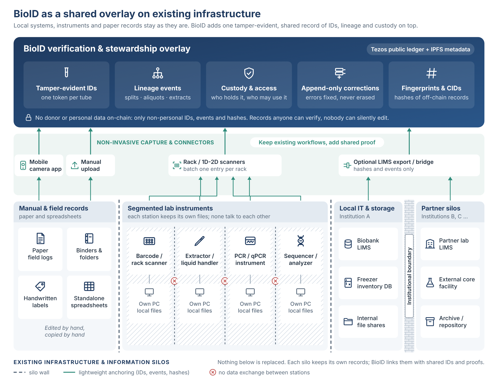
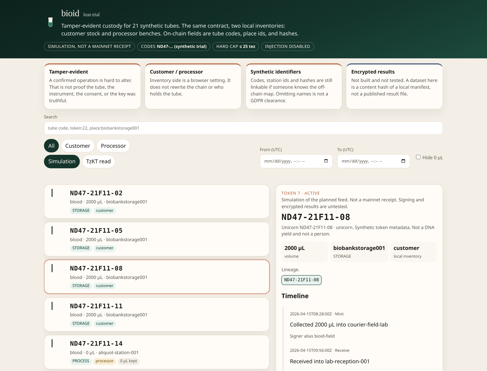

# BioID: Tamper-Evident Provenance, Consent and Distributed Stewardship for Biobank Samples on Tezos

**A white paper by the BioID project (bioid-web), version 0.4, 24 November 2026**

*For community feedback and potential adopters, 24 November 2026. All sample, volunteer and wallet data described here is synthetic.*

**How to cite.** BioID project (bioid-web). *BioID: Tamper-Evident Provenance, Consent and Distributed Stewardship for Biobank Samples on Tezos.* Version 0.4, 24 November 2026. https://doi.org/10.5281/zenodo.24321809 (concept DOI; always resolves to the latest version).

## 1. Abstract

Biobanks keep physical samples, such as blood, tissue, fecal samples, cells or other material, and the DNA extracted from them, together with metadata records of where each sample came from, who has handled it and how, what the donor agreed to and who is responsible for it. These records usually sit in separate, editable databases run by individual institutions. When trust in institutions is under strain — from the political climate, growing economic challenges, industry competition, forgery (simple or sophisticated), or the implications of AI/SI agents and the potential for even more sophisticated manipulation by participants in this ecosystem — institutions that hold records may need a further, transparent record. That record should be accessible without depending on any one institution's software, should be tamper-resistant, and should provide a long-term account of collection entries.

BioID adds a layer of trust infrastructure, using advanced mathematics and a public ledger. It records and mirrors the lifecycle of each physical tube as a token on a public blockchain. Each tube is represented as one token, its balance is its volume in microlitres (or grammes), its parent and child tubes are linked on-chain, and every handling step emits a public event. Anyone can check the record, now or decades from now, even if the institution that wrote it no longer exists, provided that the chain keeps running and that someone keeps archive copies of chain data and pins the off-chain metadata (see the durability plan in Section 3.10). Only non-personal identifiers and fingerprints go on-chain, keeping personal data off the records.

In November 2026 we ran a mainnet trial with synthetic data. 21 field tubes became 50 tokens, and 92 business events were executed as 108 on-chain operations, at a total cost of 20.87 tez (about USD 5.23 at the 10 November 2026 price of USD 0.2507 per tez). Since then the design has moved on. The current recipe, published as open code in the BioID repository (https://github.com/bioid-web/BioID), adds typed wallets with enforced transitions, a two-step ship-and-receive hand-over between sites, a reference bridge from LIMS exports, volume rules that distinguish plain splits from steps that add liquid, a withdrawal that costs the same however large the lineage, and a written threat model. The core of it has been exercised end to end on the Tezos Shadownet test network with synthetic tubes. This paper presents that recipe as the primary design, reports the November mainnet trial as history and keeps its results, and separates what was implemented from what is still future work. It ends by inviting feedback and outlining how an adopter could run a pilot.

## 2. The problem: trust in sample records

### 2.1 Provenance in silos

A sample's value depends on its history: collection, processing, storage and every transfer in between. Biobankers call this *provenance*, and the documented sequence of handovers the *chain of custody*. In most settings that history is spread across a field sheet, a laboratory information management system (LIMS), a freezer inventory and a sharing agreement. Each is controlled by one organisation and can be edited by its administrators. Audit trails exist, but they sit inside the systems they audit.

### 2.2 When institutional trust erodes

That model works as long as everyone trusts the operator. It is weaker when funding or political priorities shift, when competing companies or institutions start to doubt each other's records, or if trust is lost after someone forges records. An independent, append-only record, open to anyone to inspect, exists independently of any institutional information system. It does not replace institutional quality systems. It gives them a platform for evidence that does not depend on trusting any single party, and that can survive if personnel rotate, laboratory information systems fail, or, in the worst case, the recording institution closes entirely.

### 2.3 Consent and distributed stewardship

According to most biobank management practices, donors can withdraw consent at any time, and for this to be executed correctly, a withdrawal request has to reach every derived tube. This means that splits, DNA and extracts, wherever they are stored, would need to be flagged and removed. Meanwhile collections are increasingly built by networks of field teams, laboratories, biorepositories and different research projects. We call shared responsibility for samples and data *distributed stewardship*. This means managing samples and data on behalf of donors and contributors to science, not owning property. Without a common, neutral record, stewardship that crosses organisations needs bilateral agreements and manual reconciliation.

## 3. The BioID approach

BioID does not replace anything a biobank already uses. Field sheets, binders, standalone instruments with their own PCs, the LIMS, freezer inventories and partner systems all keep their own records as before. BioID sits on top of them as one shared, tamper-evident layer. Existing records are anchored to it through scanners, a phone camera, manual upload or an optional LIMS export, and only non-personal IDs, events and fingerprints go up. The silos stay where they are, but their records can now be checked against a common history.

**Figure 1. BioID as a shared overlay on existing infrastructure, instruments and manual records.**



### 3.1 Two short primers

**For biobank readers.** A *blockchain* is a ledger copied across many independent computers. Changing an accepted record would mean overriding the network, so the history is *tamper-evident*. A *smart contract* is a program on the chain that defines the allowed actions. A *token* is an entry in a contract with a holder and a balance; *FA2* (TZIP-12) is the Tezos token standard. A *wallet* is an address controlled by a cryptographic key. An *event* is a structured public message emitted by a contract. *IPFS* is a file network where a file's address is derived from its content. *tez* pays network fees.

**For Web3 readers.** A *biobank* is an organised collection of biological samples plus associated data. An *aliquot* is a portion split into its own tube. An *extract* is material, here DNA, isolated by a laboratory process. *Chain of custody* is the record of every handover. *Informed consent* is the donor's agreement to specific uses, which may be withdrawn. A *LIMS*, *LIS* or *BIMS* (laboratory information management system, laboratory information system, or biobank information system) tracks samples inside one institution.

### 3.2 One token per tube, typed wallets, lineage on-chain (implemented)

A single FA2 contract holds one token per physical tube. On the tube, the token is identified by a printed alphanumeric code that carries no personal meaning; on-chain, by a token id. The repository's synthetic examples use SY-prefixed codes. The mainnet trial used its own prefix (Section 4).

The balance is the volume in microlitres, so consuming material lowers the balance, and a tube that is used up stays on record at 0 µL. Splits and processing mint child tokens with a parent link, so the family tree of any tube can be rebuilt from public chain data alone. A lineage has at most eight generations, root included. The bridge refuses a ninth, and so does the v0.4 contract proposal in the repository, so every lineage query is complete. The deployed contract's lineage views already stop at eight.

Each holding wallet is registered with one of six types: `STORAGE`, `INTAKE`, `PROCESS`, `TRANSIT`, `QUARANTINE` and `EXTERNAL_USER`. The contract enforces which operations each type allows. Only a `PROCESS` wallet can transform a tube, a tube leaves a site only through a `TRANSIT` wallet, and a tube never goes straight from one site's freezer to another's. A hand-over between sites takes two signatures. The sender ships the tube into transit, and only the receiving custodian can receive it into one of their own wallets. A move of the same physical tube is a transfer of the same token, never a burn and re-mint, so the token's history is the tube's journey. The FA2 `transfer` entrypoint is disabled; custody moves only through these typed entrypoints, each with a reason code.

An existing LIMS remains the system of record. A reference bridge in the repository reads its event exports, maps LIMS locations to wallets and LIMS event types to contract operations, checks the wallet rules before anything is signed, batches events (one operation per rack scan or per batch), and skips events it has already applied. Events that break a rule go to a review queue for a person instead of to the chain. A reconciliation step compares a LIMS inventory snapshot with the ledger. Signing keys stay in an HSM or cloud key service; the bridge refuses raw secret keys and refuses mainnet.

**Figure 2. Lineage of one split field tube in the mainnet trial (history; simplified)**

```
Field tube (unicorn wallet) --> split at aliquot station (equal volumes)
                              |
              +---------------+----------------+
              v                                v
   Sister tube (troll wallet)         DNA daughter (elf wallet)
   -> biobank storage                 -> DNA instrument
                                               |
                                               v
                                 Extract (invisible elephant wallet)
                                 -> -20C lab freezer
```

In the trial, unsplit field tubes went straight to biobank storage. In the repository recipe the same path runs through typed wallets: an `INTAKE` wallet at reception, a `PROCESS` wallet for the split and for the DNA isolation, and `STORAGE` wallets for the freezers.

### 3.2a Volume, transformations and conservation (repository recipe; contract change proposed)

Because a token's balance is the volume in its tube, the record must not let volume appear from nowhere. The rule is about the *source material consumed*, not the liquid volume of what comes out. Every transformation burns a stated volume from the parent tube, and a step can never burn more than the parent holds. What the children may hold depends on the kind of step:

- **Plain aliquot or split** of the same material, with no added liquid. The children together cannot hold more than was burned. Small losses (dead volume in a pipette tip) are allowed.
- **Extraction, isolation and elution.** A DNA or RNA extraction may consume 50 µL of plasma and elute the result in 100 µL of buffer, so the output can legitimately be larger than the input. The step records its type and the volume consumed and, ideally, the elution volume added. When the added volume is recorded, the outputs cannot exceed the volume consumed plus the volume added.
- **Dilution and titration.** Adding diluent produces more volume by design. These steps must record the added volume or the dilution factor (final volume divided by initial volume), and the outputs are capped by the volume consumed plus the volume added.

Every transformation therefore leaves three numbers in the public record: what kind of step it was, how much source material it consumed, and, where liquid was added, how much. A reader can then check mass balance of the *source* across a whole lineage, even though liquid volumes grow and shrink along the way. Volume corrections after a measurement are a separate, visible step; evaporation or dead-volume corrections can only lower a volume.

**Status.** The bridge enforces these rules, and its tests cover each case. The matching contract change is compiled and tested in SmartPy as a proposal in the repository. It has not been originated anywhere yet. It will be tested on a testnet first. The lean21 mainnet contract is not re-originated.

### 3.3 Wallets, events and destruction (implemented)

Wallets represent laboratory stations, instruments, storage locations and participants — for example field, lab, aliquot station, DNA instrument, a −20 °C lab freezer, biobank storage and long-term automated sample storage — and can also represent roles or projects, an event, an instrument, a process, or a cohort. A token transfer between wallets, made from automated reports or by manual curation by staff, mirrors a physical movement. Every step (collection, transfer, split, DNA processing, extraction, storage, consent withdrawal, destruction) emits an on-chain event. A separate *confirm-destroyed* step (burn event) records that material was actually disposed of, so an instruction and the evidence that it was carried out are kept apart. In the v0.4 proposal only the custodian that holds the tube can confirm destruction, while the owner orders it, so one key never does both.

### 3.4 Keys and stewardship (design, not implemented in the trial)

In the trial one operator controlled all wallets, but in a live version, wallets may be managed by operators with different roles. The wallet controller may not be a human, but could be an agentic AI/SI with the role of an instrument or process. The intended production model is as follows.

- **Each participant controls its own wallet.** An institution running a process or long-term storage controls tokens while they move between its wallets. A project granted access to a portion of a sample holds its own wallet too. Donors never hold wallets.
- **A balance is a certificate of access.** Holding a balance shows custody of, or access to, a physical portion and potentially its data. This makes data access as tangible and countable as tubes. Tokens are custody and access records, not tradable assets. They move only between participant wallets as custody or access changes.
- **Daily operations use custodian keys.** Each location wallet is registered to a custodian organisation, and that custodian's signer keys act on tubes in its wallets, so location wallets need no keys of their own. In the background, a 2-of-3 institutional admin wallet (operator, institution backup, cold escrow) can rotate or freeze those keys. We expect this to be needed rarely.
- **History is never rewritten.** Recovery is a new, visible on-chain event. If a project or individual loses a key, its access is frozen, and the institution re-grants access through a new, visible allocation.

### 3.5 The physical-digital link (design, not implemented in the trial)

The trial used synthetic codes. In production, tubes would be registered with commercial barcode scanners reading pre-printed 1D or 2D codes on the side or bottom of the tube (for example LVL-type tubes). Scanners can read a single tube or a whole rack of up to 96 tubes, and the design batches one on-chain operation per rack scan. A second path is manual registration with a mobile phone camera inside the browser app. Each step records how it was registered (tube scanner, or done with a camera). The chain cannot be edited, so a wrong entry is never erased. Instead a new correction entry is added that says, in effect, "entry X was wrong, the right value is Y." Both stay visible, so anyone can see what happened, and the viewer shows the corrected version by default.

### 3.6 Consent withdrawal

**Production model (implemented in the repository contract and bridge; constant-cost version proposed).** Donors hold no wallets. Each root tube is linked to an *owner* role, which is institutional: the study or biobank that holds the consent record. When a donor withdraws, that institution records the withdrawal on-chain with one of three outcomes: destroy, anonymise or stop use. This freezes the root and every tube derived from it, wherever each one sits, and creates a destroy or remove order for the physical material. A later confirmed-destroyed event, one per tube, closes the order.

**Withdrawal at scale.** The deployed contract walks the lineage and marks every descendant, so the cost of a withdrawal grows with the number of tubes. The v0.4 proposal instead writes the outcome once, on the root, and every operation on any tube checks its root's outcome before it runs. A withdrawal of a lineage of a thousand tubes then costs the same as one of a single tube, and no per-lineage list grows as tubes are split. The viewer derives the frozen or stopped status from the root's withdrawal event, so the display stays the same.

**Escalation.** A stop-use outcome can later be made stricter: escalated to destroy or anonymise, as a new, visible event that records the previous outcome. No outcome can be relaxed or removed, except that a completed anonymisation reopens the lineage with its consent references cleared.

**Owner keys.** The owner address fixed at mint should be a multisig contract held by the institution, for example a 2-of-3 TzSafe wallet. Signers are added, removed or replaced inside the multisig, so a lost key or a departing person does not change the owner of any sample. We wrote and tested a contract entrypoint to move the owner role to a new address, then dropped it because the contract has to stay under Tezos's 32 KB limit for one operation. Moving the role between institutions is therefore not supported in v0.4.

**Trial (implemented, demonstration only).** Two synthetic volunteer wallets revealed their link to field tubes and withdrew consent themselves. This showed the mechanics but is not the production model, since donors will not hold wallets.

### 3.7 On-chain versus off-chain (implemented)

Only non-personal identifiers go on-chain: tube ids, station and instrument ids, processor or customer ids, and links or fingerprints (hashes) of off-chain documents. Contract metadata follows TZIP-16. Token metadata follows TZIP-21 and lives on IPFS. Trial descriptions are deliberately whimsical so that nobody mistakes them for real data: *unicorns* are field samples, samples in the *troll* wallet are sister splits to the biobank, *elf* wallet samples are DNA daughters, *invisible elephant* wallet entries are extracts, and withdrawn volunteers are kept in the unicorns wallet. Withdrawn samples will be burned on-chain, so that they no longer appear as active inventory.

**Salted fingerprints.** A plain fingerprint of a short or predictable document, such as a one-line result or a standard form, can be confirmed by guessing its content and hashing the guess. For such documents the bridge computes a salted fingerprint (HMAC-SHA256 with a 32-byte random salt). The salt is kept off-chain next to the document and shared only with someone who is meant to verify it. Large, unpredictable files can use a plain SHA-256.

### 3.8 Viewers (implemented)

**Phone viewer (repository).** A static page reads the public contract through the TzKT indexer. It does not sign and stores no keys. A user scans a tube's Data Matrix or QR code, types its code, or follows a link, and sees the current wallet, the volume, the custody timeline in local time with a link to each operation, parents and children, and datasets attached to the tube or inherited from its ancestors. A single lookup reads only that tube and its lineage, at most eight generations, so the work grows with the size of the lineage, not with the size of the collection. On the Shadownet demo a deep lineage takes about 16 indexer requests. Transient indexer errors are retried.

**Trial inspector (history).** The mainnet trial used a single HTML/JavaScript file that ran in a browser with no server. It handled configuration, CSV import and export, lookups by tube code, token id, wallet or place, lineage and time window, and full per-tube timelines.

**Figure 3. The trial HTML inspector, showing a list of synthetic tubes and the custody record of an intact field tube.**



The viewer brands itself "bioid lean trial". Some trial tube codes are omitted from this figure.

### 3.9 Threat model

The chain proves that a record was made, by which key, when, and in what order. It does not prove that a tube is in a freezer. BioID's guarantees and limits follow from that. The full threat model, with eighteen threats, the mitigation for each, its status and what risk remains, is published with the repository. In summary:

- **What the chain protects against.** Silent editing or deletion of history after the fact; back-dating; one party quietly rewriting a shared record; loss of the record when an institution's systems fail or close; volume appearing from nowhere through transformation records (Section 3.2a); a withdrawal that misses a derived tube or cannot be afforded for a large lineage (Section 3.6).
- **What it does not protect against.** A custodian who records an event that did not happen, or omits one that did (garbage in, permanent garbage); a stolen or misused key until it is replaced; collusion between the parties that order and attest; mislabelled tubes at the bench; loss of every owner key, which cannot be recovered on-chain by design.
- **Mitigations.** Typed wallets with enforced transitions; two-step ship and receive, so the receiving site confirms each hand-over; separation of the key that orders destruction from the key that attests it; reconciliation of the chain against LIMS exports; physical audits sampled against the public record; key custody in HSMs or key services; a multisig for the owner role.
- **Privacy threats.** Linkage through timing, wallet reuse and activity patterns (Section 7); guessing the content behind a bare fingerprint of a short or predictable document, which salted fingerprints address (Section 3.7); reading of off-chain metadata by people outside an agreement, which envelope encryption addresses (Section 3.11).
- **Infrastructure threats.** Indexer or RPC outages and wrong answers (the viewer retries, and verification scripts should compare two sources); loss of IPFS pins; long-term chain continuity (Section 3.10).

### 3.10 Durability (plan)

A record that is meant to outlast its institution needs more than the chain. The repository's durability plan assigns each part a keeper. Contract and token metadata are pinned on at least two independent pinning services and on one institutional IPFS node. Each quarter, contract storage, all big-map keys and all events are exported with checksums and deposited in a long-term repository, so history can be checked even if today's indexers disappear. The source code is archived in Software Heritage and released with a DOI. Salts are kept as durably as the documents they protect. The off-chain link from tube to donor is deliberately not durable beyond its legal purpose, because deleting it is how anonymisation works. The plan also sets a schedule for re-verifying the record against the chain. It is a plan, not yet a running service.

### 3.11 Keeping metadata hidden (design, not implemented)

A fingerprint is not a lock. SHA-256 is a hash: it proves that a document has not changed, but anyone who holds the document can read it, and a short or predictable document can be guessed from its hash (Section 3.7). Metadata that partners need but the public should not see therefore has to be encrypted before it is stored anywhere public, including IPFS.

The proposed design uses envelope encryption and needs no contract change.

- **Encrypt each metadata object** with its own random 256-bit data key, using AES-256-GCM with a fresh nonce. GCM also detects any change to the ciphertext.
- **Share the data key per agreement.** The data key is wrapped (encrypted) separately for each recipient named in a data-sharing agreement, with that recipient's public key or through the institution's key service. The wrapped keys are stored off-chain next to the ciphertext. A new partner gets a newly wrapped copy. A partner whose agreement ends gets nothing for new versions, which use new data keys.
- **Anchor only the ciphertext.** The encrypted object goes to IPFS or institutional storage. On-chain, `attach_data` records the URI and the SHA-256 hash of the ciphertext, so anyone can check that the stored object is unchanged without being able to read it. Public token metadata stays minimal, for example the tube code and type, and points to the encrypted object.
- **Crypto-shredding on withdrawal.** When a withdrawal requires it, the institution destroys the data keys and every wrapped copy of them. The ciphertext can stay pinned, so the public record stays intact, but nobody can decrypt it any more.

Crypto-shredding has limits. It cannot recall copies that a partner has already decrypted and saved, so agreements must require partners to delete decrypted copies and to confirm that they have. It also relies on AES-256 staying unbroken. Ciphertext pinned on a public network may be kept for decades, and future cryptanalysis, including large quantum computers, could weaken today's encryption. Data that must stay secret for a very long time, such as DNA sequence, should therefore not be put on public networks even when encrypted. Keep it in institutional storage, with only the hash anchored. Key destruction also has to be shown, for example through key-service logs, because the chain cannot prove that a key no longer exists.

## 4. Mainnet trial, November 2026 (history; implemented)

The contract is KT1DgrZrWrdTjf7sENXVctihhpDHfU4RTpdy on Tezos mainnet (https://tzkt.io/KT1DgrZrWrdTjf7sENXVctihhpDHfU4RTpdy). Contract metadata is at ipfs://bafkreidy445g56sdex2papffyfcjo4v57ihjsimljwaojbihih2e7poyka and the token metadata index at ipfs://bafkreifkmvtna6yk4atwhdssiuv5zugjlsrlj26qop2ajr6ly5vxinybwa. In the scenario used for this proof-of-concept run, 21 synthetic field tubes were registered. 11 went intact to biobank storage. 10 were split equally into a sister tube for the biobank and a DNA daughter, which went through a DNA instrument. 9 DNA daughters produced extracts moved to a -20C freezer, and one was consumed without an extract. Two synthetic volunteer wallets withdrew consent.

**Table 1. Trial numbers**

| Measure | Value | Measure | Value |
|---|---|---|---|
| Field tubes | 21 | Extracts to -20C freezer | 9 |
| Tokens at end | 50 | DNA daughters consumed, no extract | 1 |
| Intact to biobank storage | 11 | Synthetic consent withdrawals | 2 |
| Split (sister + DNA daughter) | 10 | Business events / on-chain operations | 92 / 108 |
| Total cost incl. setup and origination | 20.873141 tez | Hard cost cap | 25 tez |

The 50 tokens are 21 field tubes, 10 sister tubes, 10 DNA daughters and 9 extracts. Two example tokens are DNA daughter ND47-21D11-12, token 22 (https://tzkt.io/KT1DgrZrWrdTjf7sENXVctihhpDHfU4RTpdy/tokens/22), and an extract, token 41 (https://tzkt.io/KT1DgrZrWrdTjf7sENXVctihhpDHfU4RTpdy/tokens/41). Every operation was simulated before submission and its cost metered live against the 25 tez cap, with an abort threshold.

**Lessons.** First, fee, storage and gas limits must include internal operations, because emitted events count. Second, submitting is not inclusion. The runner needed RPC confirmation, resume-and-reconcile against on-chain state after interruptions, and idempotent steps so that a retry cannot duplicate a split. Third, public indexers and RPC nodes sometimes returned transient errors, so tools must retry and cross-check.

**Relation to the current recipe.** The trial contract is an earlier design. The repository recipe that this paper now describes as primary was tested afterwards on the Shadownet test network with synthetic tubes. The trial's numbers and lessons stand, and the third lesson (retry and cross-check) is now implemented in the repository viewer's indexer client.

**What the trial does not show.** It does not show production volumes, scanner integration, multi-party key custody, real LIMS integration, legal acceptability in any jurisdiction, or real operator usability or day-to-day operation.

## 5. Why Tezos

The trust argument depends on a chain that is affordable, reliable and likely to keep running for decades. Our reasons for choosing Tezos are judgements, not measurements.

- **Fees and speed.** Ethereum is currently one of the most widely adopted smart-contract chains, but its main network has generally been slower and is generally more expensive per operation, and per-tube records need low fees, particularly for larger projects. Ethereum moved to proof of stake in 2022, so energy use is not a reason to avoid it.
- **Reliability.** Solana offers low fees but has had network outages. For a record meant to last, we weigh that heavily.
- **Security.** Tezos contracts are written in Michelson, a language designed to support formal verification, and the platform has a solid security track record.
- **Upgrades and energy.** Tezos amends itself through on-chain governance, upgrading without hard forks. Its proof-of-stake consensus is energy-efficient.
- **Continuity.** Tezos has a large NFT collector community. Our hypothesis, which we have not tested, is that such a community gives people lasting reasons to keep the chain running.
- **Institutional use.** Established organisations have used Tezos. For example, Société Générale issued a structured product as a security token on the Tezos public blockchain in 2021 (https://www.societegenerale.com/en/news/press-release/first-structured-product-public-blockchain), and its SG-FORGE unit selected Tezos for central bank digital currency experiments (https://www.sgforge.com/tezos-selected-by-societe-generale-forge-for-its-central-banking-digital-currency-experiment/). This does not imply any endorsement of BioID.

The concept described here is chain-agnostic in principle. Apart from Tezos-specific adaptations, it could be deployed on other chains.

**A comparison with de-bi.** The closest published design, de-bi (Section 5a), uses ERC-1155 tokens on Ethereum and notes that a layer 2 network will be needed for cost. We have not measured de-bi's costs, so this comparison is qualitative. BioID's per-tube cost on Tezos mainnet was measured in the trial (Section 4), and rack batching should lower it further without a second network. On transferability, de-bi's specimen tokens are transferable, while BioID disables free transfer, so a token can move only when a typed custody step happens. The two designs suit different aims: de-bi treats specimens as assets that circulate within a research network, and BioID treats tokens as stewardship records that mirror where a physical tube is.

## 5a. Related work

A fuller survey, with a positioning table and checked links, is published with the repository. The closest work falls into four groups.

**Consent on a ledger.**

- **Dynamic consent** (Kaye et al., European Journal of Human Genetics, 2015; https://doi.org/10.1038/ejhg.2014.71) lets participants follow and change their consent over time through a digital interface. BioID's withdrawal outcomes are the on-chain end of such a process. The interface itself stays with the institution.
- **Dwarna** (Mamo et al., European Journal of Human Genetics, 2019; https://doi.org/10.1038/s41431-019-0560-9) records dynamic-consent changes for the Malta Biobank on a permissioned blockchain (Hyperledger Fabric) and argues GDPR erasure by keeping identifying data off-chain. It covers consent, not physical custody or volume.
- **ConsentChain** (Albalwy, Brass and Davies, JMIR Medical Informatics, 2021; https://doi.org/10.2196/27816) uses Ethereum smart contracts to grant, withdraw and request access to clinical genomic data. It notes that verifying the credentials of users is still an open problem, and BioID shares that gap.
- **Demonstrated consent** (American Journal of Bioethics 25(4), 2025; https://doi.org/10.1080/15265161.2024.2416117) proposes one NFT per donated sample whose metadata records planned and past uses, explained to donors by a language model. Published responses question whether technology builds trust (for example https://doi.org/10.1080/15265161.2025.2470646). BioID shares the one-token-per-sample idea but keeps consent records off-chain and gives donors no wallets.

**Samples and data on a ledger.**

- **de-bi** (Frontiers in Blockchain 8, 2025; https://doi.org/10.3389/fbloc.2025.1510429) models an organoid biobank with ERC-1155 tokens on Ethereum, including soulbound identity tokens and transferable specimen tokens. It is the closest existing design. BioID differs in volume-as-balance, one token per physical container, disabled free transfer, enforced wallet-type transitions and the ship-then-receive hand-over (Section 5).
- Early reviews of blockchain in clinical research (Benchoufi and Ravaud, Trials, 2017; https://doi.org/10.1186/s13063-017-2035-z) and in biomedicine (Kuo, Kim and Ohno-Machado, JAMIA, 2017; https://doi.org/10.1093/jamia/ocx068) set out the case for tamper-evident records and their limits.
- Genomic data platforms such as Nebula Genomics (Grishin, Obbad and Church, Nature Biotechnology, 2019; https://doi.org/10.1038/s41587-019-0271-3) give individuals control over access to their own data. They track data, not physical tubes.

**Supply-chain tracing.** GS1 EPCIS 2.0 (ISO/IEC 19987:2024; https://ref.gs1.org/standards/epcis/2.0.1/) is the supply-chain event standard. Its ObjectEvent fits ship and receive, and its TransformationEvent, with input and output quantity lists, fits splits, extractions and dilutions. The BioID bridge now exports a tube's lineage as an EPCIS 2.0 document, checked against the GS1 JSON schema. The US Drug Supply Chain Security Act (https://www.fda.gov/drugs/drug-supply-chain-integrity/drug-supply-chain-security-act-dscsa) shows that package-level tracing between many parties can work at scale.

**Identity, provenance and packaging standards.** W3C Verifiable Credentials 2.0 (https://www.w3.org/TR/vc-data-model-2.0/) and GA4GH Passports (Voisin et al., Cell Genomics, 2021; https://doi.org/10.1016/j.xgen.2021.100030) could show that a requester's institution approved an access request, which would close the wallet-identity gap. W3C PROV-O (https://www.w3.org/TR/prov-o/) describes a transform as an activity that uses a parent and generates children. RO-Crate (https://doi.org/10.3233/DS-210053) fits the datasets attached to a tube.

**Regulatory guidance.** The European Data Protection Board's Guidelines 02/2025 on processing personal data through blockchain technologies (version 2.0, adopted 7 July 2026; https://www.edpb.europa.eu/documents/guideline/guidelines-022025-on-processing-of-personal-data-through-blockchain_en) advise keeping personal data off-chain, with only commitments or pointers on-chain, and documenting why a blockchain is needed. BioID's design follows that line, and an adopter still needs a data protection impact assessment.

## 6. Compliance and governance

**GDPR.** Under the General Data Protection Regulation (GDPR), pseudonymous identifiers can be personal data if they can be linked to a person. In BioID, tube codes are independent identifiers that carry no personal meaning on-chain. The only link from a tube to a donor sits in the biobank's own off-chain records, under its normal safeguards. Blockchains are append-only, which conflicts with erasure requests. BioID's answer is to never put personal data on-chain, so that erasure means destroying the off-chain links and keys, in line with the European Data Protection Board's guidance (Section 5a). Data packets are a harder case, because they may contain DNA sequence, which can in principle identify a person specifically. Such data would therefore be encrypted off-chain, with only fingerprints and versions on-chain (Section 7). We recommend a formal review by a data protection officer and legal counsel before any real deployment. This paper does not claim compliance.

**ISO 20387:2018** sets general requirements for biobanking, including traceability. BioID is meant as a supporting traceability record, not a replacement for a quality management system. Any claim of conformity would need proper assessment.

**BBMRI-ERIC and ELSI.** BBMRI-ERIC, the European research infrastructure for biobanking, emphasises ethical, legal and societal issues (ELSI). Relevant questions here are transparency to donors, respect for withdrawal, fair governance of shared collections, and avoiding any impression that samples are speculative assets. BioID tokens are stewardship records only.

**FAIR.** Content-addressed metadata linked to each token supports the FAIR principles (Findable, Accessible, Interoperable, Reusable). Real deployments need community metadata schemas, not fairy tales.

**Governance.** Roles for deploying contracts, running station wallets, registering tubes, confirming destruction and holding admin keys must be agreed between participants, and are therefore adaptable to specific ecosystems. On-chain records cannot be edited, however, so corrections are always new, linked records.

## 7. Implemented since v0.3, and future work

**Implemented in the repository since v0.3.** Typed wallets with an enforced transition matrix; two-step ship and receive; a reference LIMS bridge with batching, idempotent replay, a review queue and reconciliation; volume rules by transformation type; per-tube viewer queries; an explicit eight-generation lineage limit; salted fingerprints; an EPCIS 2.0 export; a threat model and a durability plan. The contract changes (volume rules, constant-cost withdrawal, escalation, depth limit, custodian-only destruction) are tested proposals that still need a testnet origination.

**Future work (not implemented).**

- **Testnet origination of the v0.4 proposal.** A dry run on Shadownet (simulated, not sent) measured the origination at 32,612 bytes including the signature, 156 bytes under the 32,768-byte limit. Further features will need space to be freed first, which is planned for a later upgrade.
- **Encrypted, versioned data files.** Large result files and hidden metadata would be stored encrypted off-chain with the envelope design in Section 3.11. DNA data stays in institutional storage. Only references, fingerprints of the ciphertext and version numbers would go on-chain, so the chain proves that a given version existed without exposing it. Storage would be chosen for cost, durability and jurisdiction, not limited by blockchain size.
- **Key management.** This means implementing the custodian and admin key model in Section 3.4 in a signing service, including rotation, freezing and staff turnover, and setting up the owner multisig.
- **Running the durability plan.** Assign the pinning, export and verification roles in Section 3.10 to named teams, and run the first quarterly export.
- **Requester identity.** Link access requests to a Verifiable Credential or Passport visa (Section 5a).
- **Linkability risk.** Timing, wallet reuse and activity patterns could make records linkable without any personal data on-chain. This needs formal analysis.
- **Tamper-evident result reporting.** Encrypted results could be delivered to authorised projects through the same wallets that hold access, giving one trail from sample to result.
- **Distributed stewardship and data-sharing agreements.** Joint stewardship of collections could be recorded on-chain, with agreements linked by fingerprint.
- **Interoperability and federation.** The bridge already reads LIMS exports and writes EPCIS. BioID could later link several biobanks sharing contracts or conventions. Inspection of the provenance may be by humans going through general-purpose HTML viewers, or other access systems, while agentic AI will have access to the chain via a Tezos explorer or similar data sources.
- **Scale.** Rack batching comes first. A cheaper layer 2 network is an option only if it is stable and likely to last, because longevity is the core of the trust argument. Until then we stay on Tezos mainnet for simplicity.

## 8. Limitations, feedback and piloting

**Limitations.** The trial was small, synthetic and run by one operator. On a public chain all activity is visible to everyone, which supports transparency but demands careful privacy design. RPC nodes and indexers are outside a biobank's control. The app is a prototype. No regulator, ethics committee or auditor has reviewed the design.

**Costs.** The trial cost 20.87 tez (about USD 5.23 at the 10 November 2026 price of USD 0.2507 per tez) for 108 operations, including setup and origination. Costs depend on network fees, the tez price and on-chain storage per step, so they must be re-measured for any deployment. Rack batching should reduce per-tube cost.

**We invite feedback.** We especially want to hear from biobank professionals, data protection specialists, ethics reviewers and the Tezos community. Useful questions include: is the stewardship and key model workable in your institution? Is the GDPR reasoning sound? What would an auditor need to see?

**How an adopter could pilot BioID.**

1. Choose a small, low-risk workflow, such as one collection-to-storage path, and start with synthetic or dummy tubes.
2. Map stations, instruments and storage to typed wallets, and agree roles and key custody, including the 2-of-3 admin wallet and the owner multisig.
3. Connect the reference bridge to a LIMS export, and use the phone viewer with existing barcode scanners or phone cameras.
4. Run the repository's test suites, including the volume-conservation, withdrawal and lifecycle tests. Deploy the contract first on a Tezos test network, then on mainnet with a hard cost cap and simulation of every operation.
5. Run the workflow, including a withdrawal and a confirmed destruction, and compare the on-chain record against your LIMS exports.
6. Review the results with your data protection officer, quality manager and ethics committee before using any real samples.

BioID is offered as a concrete, inspectable starting point for that conversation, not a finished product.

## Changes since v0.3

- The repository recipe is now the primary design. The November mainnet trial is reported as history, with its results unchanged.
- New: typed wallets, ship and receive, and the LIMS bridge (Section 3.2).
- New: volume rules by transformation type (Section 3.2a).
- New: constant-cost withdrawal, stop-use escalation, a multisig owner, and custodian-only confirmation of destruction (Sections 3.3 and 3.6).
- New: salted fingerprints (Section 3.7); the phone viewer with per-tube reads (Section 3.8); the threat model (Section 3.9); the durability plan (Section 3.10); a design for keeping metadata hidden with envelope encryption and crypto-shredding (Section 3.11).
- New: a comparison with de-bi (Section 5); expanded related work (Section 5a); a split between what is implemented and what is future work (Section 7).
- The repository's CHANGELOG lists the code changes.

## A personal note

Thank you for reading this far. BioID began with a simple question: can the history of a tube outlast the systems that record it? The trial and the recipe that followed it are a first, small answer, and it will only get better with other people's eyes on it. Please test the ideas, try to break them, and leave constructive comments as issues in the GitHub repository (https://github.com/bioid-web/BioID/issues). If you are trying something similar in your own biobank or lab, I would love to hear how it goes. Good luck!

*— Jack*
