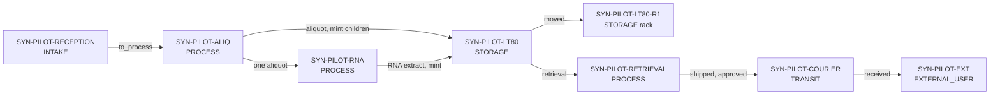

# Synthetic public demo

A visitor can read this folder without an account. Nothing here is a real tube, a real person, or a registered name. The addresses fail checksum validation on purpose, so they are not Tezos accounts. Names such as `reception.pilot.example.tez` are labels only.

Checked on 19 October 2026: [Tezos Domains](https://developers.tezos.domains/) documents mainnet contracts for `.tez`. [teztnets.com](https://teztnets.com/shadownet) does not list a Shadownet name registrar. These names are not registered and do not resolve. The readable name is the `label` in [`wallet-registry.json`](wallet-registry.json).

## What the story is

Three synthetic blood tubes arrive at reception. They are aliquoted. Most daughter tubes go to a −80 °C freezer, and one of those is later moved onto a rack in that freezer. One aliquot goes to RNA isolation. The extract is a new tube, stored in the same freezer. One stored aliquot is then retrieved for an external user: an access request, an approval, a pick from the freezer, a shipment, and a receipt. The recipient uses part of the volume and attaches a result.



Positive balances at the end of [`scenario.events.jsonl`](scenario.events.jsonl):

| Tube | What it is | µL | Wallet |
|---|---|---|---|
| `SY00000211` | aliquot of `SY00000201` | 1000 | `SYN-PILOT-LT80` |
| `SY00000222` | aliquot of `SY00000202` | 1500 | `SYN-PILOT-LT80` |
| `SY00000231` | aliquot of `SY00000203` | 2000 | `SYN-PILOT-LT80-R1` |
| `SY00000241` | RNA extract of `SY00000212` | 80 | `SYN-PILOT-LT80` |
| `SY00000221` | aliquot sent to the guest | 600 | `SYN-PILOT-EXT` |

Parents `SY00000201`, `SY00000202`, `SY00000203` and `SY00000212` stay at 0 µL. They are not deleted.

Dataset links, all on `example.org` or the example DOI prefix `10.5555`:

| Step | Tube the event names | Link |
|---|---|---|
| Reception QC | `SY00000201` | `https://example.org/synthetic/pilot/qc/SY00000201` |
| Aliquot volume check | `SY00000201` | `https://example.org/synthetic/pilot/volume/SY00000201` |
| RNA RIN | `SY00000212` (the parent; the extract is `SY00000241`) | `https://example.org/synthetic/pilot/rin/SY00000241` |
| Freezer temperature log | `SY00000211` | `https://example.org/synthetic/pilot/temperature/SY00000211` |
| External-use result | `SY00000221` | `https://example.org/doi/10.5555/example.synthetic.pilot-use` |

The contract view `lineage_has` walks `parent_id`, so the RNA extract shows the RIN recorded on its parent. The files themselves are not in this repository.

## FAIR

| FAIR | Where it shows up |
|---|---|
| Findable | Each tube has a code (`SY000002xx`) and a metadata URI on the token. Dataset URIs are attached to the step that produced them. |
| Accessible | The access procedure is the pair `access_requested` / `access_approved` in the feed. Approval is what allows the retrieval wallet to ship. The agreement id `mta-syn-pilot-001` is opaque. The document stays off-chain. |
| Interoperable | Wallet temperature uses the MIABIS-SAMPLE-03 string `-60 °C to -85 °C`. The request carries the DUO code `GRU` as a string. A LIMS adapter can project the tube to FHIR Specimen. Those mappings are described in [Wallet types](../docs/wallet-types.md). This demo does not claim a full MIABIS or FHIR document. |
| Reusable | The agreement reference, the reason codes, and the parent links are the provenance. A later result URI can point at a dataset or a paper. The example DOI is not a real publication. |

## Replay the feed locally

From `bridge/`, with the package on `PYTHONPATH`:

```bash
PYTHONPATH=src python3 -m bioid_bridge replay \
  --registry ../pilot/wallet-registry.json \
  --mapping ../pilot/lims-mapping.json \
  --events ../pilot/scenario.events.jsonl \
  --db :memory:
```

The mock ledger applies the feed. It does not contact a network.

## Live demo on Shadownet (testnet)

The feed above has been replayed on the Tezos **Shadownet testnet** (chain id `NetXsqzbfFenSTS`, RPC `https://rpc.shadownet.teztnets.com`). Nothing here touches mainnet. The addresses are throwaway testnet accounts and the tubes are still synthetic. Everything the replay wrote is in [`deployments/shadownet.json`](deployments/shadownet.json): the contract, every wallet address with its label, and one operation hash per event.

Contract: [`KT1HpDatoa5tHDctAQDY7wQgVEnrWJ9S3vix`](https://shadownet.tzkt.io/KT1HpDatoa5tHDctAQDY7wQgVEnrWJ9S3vix) (origination [`onssPPtP…`](https://shadownet.tzkt.io/onssPPtPBAQoPEf9PQxFJmCfmnGPzXA4xgvSSxHHc3fqmyihPEW)).

| Label | Type | Shadownet address | Label only, not a registered name |
|---|---|---|---|
| `SYN-PILOT-RECEPTION` | INTAKE | [`tz1P2Gdj…PAxM`](https://shadownet.tzkt.io/tz1P2GdjP5jLPeCLbsMoTibVLBEBViV8PAxM) | `reception.pilot.example.tez` |
| `SYN-PILOT-ALIQ` | PROCESS `aliquoted` | [`tz1PUjA2…8TrQ`](https://shadownet.tzkt.io/tz1PUjA22fzw5PvHgAomCn7wRspZTejb8TrQ) | `aliquot.pilot.example.tez` |
| `SYN-PILOT-RNA` | PROCESS `rna_isolation` | [`tz1X8iBM…uhZmt`](https://shadownet.tzkt.io/tz1X8iBMUk5fqqZTDZxNiCsuahNcU4XuhZmt) | `rna.pilot.example.tez` |
| `SYN-PILOT-RETRIEVAL` | PROCESS `retrieval` | [`tz1Q34XA…YZKu`](https://shadownet.tzkt.io/tz1Q34XARdjTAwgYbW2oUprsXv3hEW2xYZKu) | `retrieval.pilot.example.tez` |
| `SYN-PILOT-LT80` | STORAGE freezer | [`tz1agcNQ…ftuP`](https://shadownet.tzkt.io/tz1agcNQ8d4hr6WbC9fr44LB2GFVQmM2ftuP) | `lt80.pilot.example.tez` |
| `SYN-PILOT-LT80-R1` | STORAGE rack in `SYN-PILOT-LT80` | [`tz1LUbET…k7LtQ`](https://shadownet.tzkt.io/tz1LUbET85n3iDaqSdJHUridP3UDesAk7LtQ) | `lt80-r1.pilot.example.tez` |
| `SYN-PILOT-COURIER` | TRANSIT | [`tz1aDbc6…BEjM`](https://shadownet.tzkt.io/tz1aDbc66yxLfDncBHKrjJ75Ks1arLUyBEjM) | `courier.pilot.example.tez` |
| `SYN-PILOT-EXT` | EXTERNAL_USER | [`tz1btjx8…as95E`](https://shadownet.tzkt.io/tz1btjx86W3eGocsnVEK1QNDzBjzypBas95E) | `guest.pilot.example.tez` |

Custodians sign; holding wallets never do. `syn-pilot-lab` is [`tz1Wnwhd…6cyT`](https://shadownet.tzkt.io/tz1Wnwhd9pbHzqGpM2Yp4gwNUSLm8nGL6cyT), `syn-pilot-courier` is [`tz1WE11R…XTVt`](https://shadownet.tzkt.io/tz1WE11R6Kq5by5EFatjLNbcmWSCmnmyXTVt), `syn-pilot-guest` is [`tz1SmhAo…yzjr`](https://shadownet.tzkt.io/tz1SmhAoMRGva9jchN7uM8EtVaXrFExdyzjr). The admin that registered the wallets is [`tz1hFmJ2…GYsch`](https://shadownet.tzkt.io/tz1hFmJ2xbV6HPk84iYwJ8gv1suKDxsGYsch).

Operations worth opening:

| Step | Event | Operation |
|---|---|---|
| Reception mint `SY00000201` | `pilot-001` | [`ooMioaer…`](https://shadownet.tzkt.io/ooMioaerapC5bJX3UJM7xM6fQER93S1HQ1zNdJQUMEkgvpLMg6Q) |
| Reception QC attached | `pilot-004` | [`oojnGmZX…`](https://shadownet.tzkt.io/oojnGmZXGYrdgqPoEEwkx8rskWnZDv4Xb9bigugo3gmey9UP5mN) |
| Aliquoting transform `SY00000201` → `SY00000211`, `SY00000212` | `pilot-008` | [`oouq1kc6…`](https://shadownet.tzkt.io/oouq1kc6BmetJ15HXFZ3PakbeYqyQ1u4kRpNyfj2qR7PYnykBah) |
| Stored in −80 °C with temperature log | `pilot-011` | [`opLWebH1…`](https://shadownet.tzkt.io/opLWebH14jZncoEd6xHuuRCmyxVdTKZNXFb73EiTvqiBuuM3b3W) |
| RNA isolation `SY00000212` → `SY00000241` with RIN | `pilot-016` | [`ooyJicED…`](https://shadownet.tzkt.io/ooyJicEDCLznGpQVdx3Gzk1yXCm3EB2PYTukFRdKuFfz2kLAw6d) |
| Freezer → rack | `pilot-017` | [`ooPYG8zR…`](https://shadownet.tzkt.io/ooPYG8zRmPcAD9BVVXKeiXsFTKofi1dDUKySWZdc5sny5A2QTB1) |
| Access request / approval | `pilot-018` / `pilot-019` | [`oo9Pe11f…`](https://shadownet.tzkt.io/oo9Pe11fYckbCzpjzu6CLzbwoXYF2joC2qwY9THoAweEX4KqHMR) / [`onktbjzN…`](https://shadownet.tzkt.io/onktbjzNNJMZLBTVqPTUUudBnt1yaUw7sop3m1wCMseBv19JVen) |
| Retrieval from freezer | `pilot-020` | [`oo9eDJmY…`](https://shadownet.tzkt.io/oo9eDJmYKy4wyG2NaC3JkPtDEe41sr7z4enC8bBkFd5tbxvNyGb) |
| Ship via courier (TRANSIT) | `pilot-021` | [`oo3xn4Ag…`](https://shadownet.tzkt.io/oo3xn4AgQKpEXZDWFUyLsDyaWPQF5btkEvdiaVRAtQAd4Xq547o) |
| Received by external user | `pilot-022` | [`oo5GFVh3…`](https://shadownet.tzkt.io/oo5GFVh3GMtFhy5RtKjdsxSSASDRzoVokK2PjA7f9pb38iuVpPa) |
| `report_use` consumed 400 µL | `pilot-023` | [`ooy57ERY…`](https://shadownet.tzkt.io/ooy57ERYhkvJBYMMSVLeeCU4TuXWQJ63Ayfe9nbtkeF8yEXbUoq) |
| External-use result attached | `pilot-024` | [`opKbfrWm…`](https://shadownet.tzkt.io/opKbfrWmxuDxRwCSJ7RKNg3WcoYoqcSN83zfqwb9pfTEvBpJiw1) |

The on-chain end state matches the balance table above: token ids 0–2 (`SY00000201`–`203`) and 4 (`SY00000212`) are at 0 µL; 3 `SY00000211` 1000 µL, 6 `SY00000222` 1500 µL and 8 `SY00000241` 80 µL sit in `SYN-PILOT-LT80`; 7 `SY00000231` 2000 µL is in `SYN-PILOT-LT80-R1`; 5 `SY00000221` 600 µL is with `SYN-PILOT-EXT`.

### Reading it on TzKT

1. Open the contract page. **Storage** shows `wallet_registry` (the labels above), `code_index` (tube code → token id) and `tokens` (balance in µL, holding wallet, `parent_id`, status).
2. Open an operation and read its events: `MINT`, `MOVE`, `SHIP`, `RECEIVE`, `TRANSFORM`, `CONSUME`, `DATA_ATTACHED`, `ACCESS_REQUEST`, `ACCESS_APPROVED`.
3. Standard FA2 `transfer` is disabled and fails with `BIOID_TRANSFER_DISABLED`. Custody moves are the tagged operations above.

### Replaying it yourself

[`run_shadownet.py`](run_shadownet.py) maps each feed event to a contract call and signs it with `octez-client`. It refuses mainnet, refuses a non-Shadownet RPC, checks the chain id, refuses a key directory inside the repository, and only injects when `BIOID_LIVE_SHADOWNET=1` is set. Without it, it prints the calls (dry run).

```bash
export TEZOS_NETWORK=shadownet
export TEZOS_RPC_URL=https://rpc.shadownet.teztnets.com
export TEZOS_CLIENT_DIR=/somewhere/outside/the/repo   # octez-client keys for the admin and custodians
python3 pilot/run_shadownet.py register               # dry run
BIOID_LIVE_SHADOWNET=1 python3 pilot/run_shadownet.py register
BIOID_LIVE_SHADOWNET=1 python3 pilot/run_shadownet.py replay
```

To start over, originate a fresh contract (see [contracts/README.md](../contracts/README.md)), generate your own testnet keys, and put your addresses in a copy of `deployments/shadownet.json`. The tube codes are unique per contract, so the same feed cannot be replayed twice on one KT1.

The placeholder addresses in [`wallet-registry.json`](wallet-registry.json) still fail checksum on purpose. The real testnet addresses live only in `deployments/shadownet.json`.
